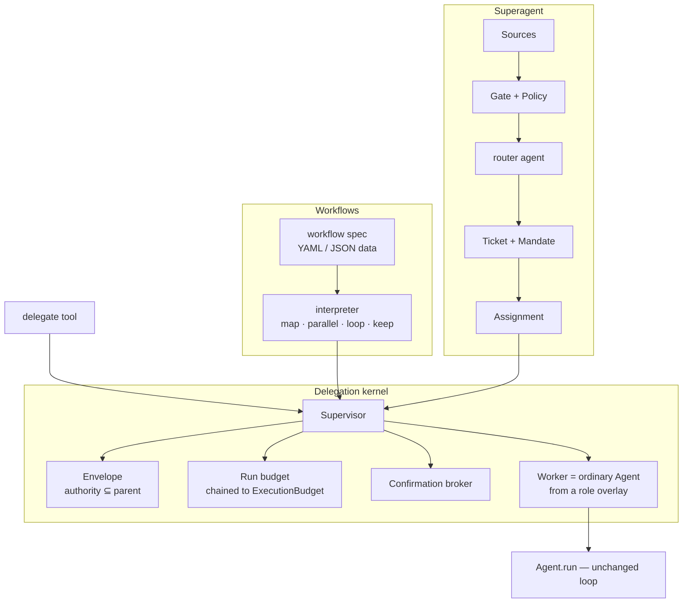
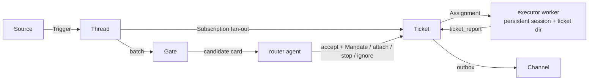

# Delegation, workflows and the superagent — design proposal

Status: **proposal, not implemented** (2026-11-10). The open decisions were
settled the same day and are recorded in [§12](#12-decisions). The proposed
layers change no current behaviour until a phase in [§10](#10-phased-plan)
lands. Where the proposal touches an invariant in `CLAUDE.md`, the amendment is spelled out in
[§9](#9-invariant-amendments).

The implementation baseline already includes the experimental `output_rewrite`
runtime stage and the coding profile's `/init` / `world` tool. These are separate
from the proposed delegation kernel. Runtime observations live in private state
(default `.lingcore/world.md`), require explicit per-save approval, and never
rewrite the authored profile file. `UsageReported.purpose` and the persisted
`TokenUsage.purpose` distinguish rewrite requests from the main context; old
records default to `main`. The sections below describe future changes relative
to that baseline, not a claim that those existing APIs are unchanged from older
LingCore releases.

References studied:

- Claude Code's dynamic **Workflow** tool: a script the model writes that
  orchestrates subagents with `agent()` / `parallel()` / `pipeline()` /
  `phase()`, structured outputs, a shared hard token budget, background
  execution with completion notification, and journal-based resume.
- [`deepseek-ai/dsh-superagent-prototype`](https://github.com/deepseek-ai/dsh-superagent-prototype):
  a proactive team agent. Sources produce Triggers. A deterministic gate and a
  routing session turn them into Tickets with immutable Mandates. One Executor
  session and directory per Ticket does the work, and results return through
  Channels, with durable effects and restart recovery.

## 1. Summary

LingCore gets **one new primitive** and **two layers that use it**:



- **L1, the delegation kernel** (`lingcore/delegation/`). It starts a *worker*:
  an ordinary `Agent` assembled from a *role* (a profile overlay). The worker
  runs under an *envelope* whose authority can only be narrower than its
  parent's, with a run budget charged against the parent, a confirmation
  broker in place of a user, and a structured *report* as its result. It is
  exposed directly as the `delegate` tool.
- **L2a, workflows** (`lingcore/workflows/`). These are deterministic control
  flow over workers. The model may write a spec on the fly (the "dynamic"
  part), but a spec is **data** run by a bounded interpreter. It is never
  code the host executes. Profiles ship named specs, and trusted plugins may
  ship Python workflows.
- **L2b, the superagent** (`lingcore/superagent/`). A long-running service turns
  events from Lark/Feishu (v1; other sources later) into authorized Tickets. A router agent
  that only routes assigns them to executor workers, and a durable store
  survives restarts.

Each layer can ship and be tested on its own. L1 is useful alone, and L2a and
L2b are thin over it.

## 2. What we take from each reference

### 2.1 Claude Code dynamic workflows

| Idea | Keep? | LingCore form |
| --- | --- | --- |
| Control flow in a program, not in the model's turn-by-turn choices | Yes | Workflow spec interpreted by the runtime |
| The model writes the program for this task | Yes, as **data** | `workflow_run(spec=…)`, validated before anything runs |
| Program language is JavaScript run by the host | **No** | LingCore has no sandboxed interpreter. Model-written Python in-process would be arbitrary code execution outside the `run_shell` sandbox. Operator Python only via consented plugins |
| `agent(prompt, {schema})` returns a validated object | Yes | `output:` schema → worker's `submit_result` tool, validated at the tool layer so the model retries on mismatch |
| `pipeline()` by default, `parallel()` only as a real barrier | Yes | `map` (no barrier between stages) vs `parallel` (barrier) |
| Failed agent → `null`, run continues | Yes | Same, **plus** counts of dropped items always logged ("no silent caps") |
| Concurrency cap, total-agent cap, item cap | Yes | `delegation.limits` + per-spec narrowing |
| Shared hard token budget (`budget.remaining()`) | Yes | Run budget chained into `ExecutionBudget` |
| `isolation: 'worktree'` | Yes, **different shape** | The `git` tool deliberately refuses linked worktrees and alternates (`lingcore/tools/builtin/git.py:111`). Use a hardened local *snapshot* clone and return changes as a patch artifact |
| Runs in background, notification on completion | Yes | Background run → `BackgroundInbox` delivery turn (the `process_monitor` pattern) |
| Resume: replay cached results from a journal | Yes | Journal keyed by **content + occurrence**, not position. Nondeterminism degrades to a cache miss, never to a wrong reuse |
| Explicit user opt-in because of cost | Yes | Tool in the `tools:` ceiling (operator) + cost-preview confirmation per run (user) |
| Subagent types | Yes | **Roles**: operator-authored profile overlays |

### 2.2 DSH superagent

| Idea | Keep? | LingCore form |
| --- | --- | --- |
| Host enforces authority. Prompts and quoted text are data | **Yes, central** | Envelope (L1) and Mandate (L2b) computed in code. Briefs, reports and triggers never authorize |
| Router only routes, never designs or investigates, never waits | Yes | Router role whose tool ceiling has *no* file/shell tools. Results arrive as turns, never polled |
| Forward the original request, not the router's paraphrase | Yes | Every brief carries the originating request verbatim, quoted as data |
| One session + one directory per unit of work | Yes | Executor workers get a persistent session and a `ticket` workspace |
| Structured report states + one concrete question | Yes | `progress / waiting / ready / blocked / failed / dropped` + `question` |
| Store first, act after commit. Durable effects with backoff | Yes | Superagent store + effects table. Run journal for L1/L2a |
| Worker slots with one reserved for a person's follow-up | Yes | Executor slots + reserved human slot |
| Restart: interrupted work restarts with a recovery note | Yes | Same note: "check the directory, git state and channel before repeating outside actions" |
| Attention economy: speak only when someone must act | Yes | Workers never address the user. Questions bubble up as structured fields. Confirmations brokered and serialized |
| Few concepts. One writer per state. Pure core without I/O | Yes | `superagent/core/` is synchronous and I/O-free |
| Model-surface size tests | Yes | A test bounds every model-facing description/prompt added here |
| Workers run commands **without approval** as the OS user | **Not on the host** | Executors inherit the profile's fail-closed sandbox and run inside it without approval. The host runner is refused ([§6.6](#66-unattended-execution)) |
| GitHub PR following, Correlation, admission tables | Defer | Source-specific extensions later. The core keeps an allowlist + accept mode |

### 2.3 What LingCore already has that this builds on

| Need | Existing seam |
| --- | --- |
| Run an Agent to completion without a human | `execution.run_headless` / `ScriptedFrontend` (deadline, Stop handshake, bounded cleanup, typed `ExecutionOutcome`) |
| Hard request/tool/token/wall limits | `ExecutionBudget` + `InstrumentedClient(budget=…)` |
| Start a turn from background events, safely | `BackgroundInbox` + `run_session` (`supports_background`, paused after Stop) |
| Kill on rollback of the starting turn | `turn_rolled_back(started_at)` pattern in the process plugin |
| Delegation to an outside agent | `outer_agents.py` (Codex / Claude Code CLIs) |
| Lineage between sessions | `fork_session` provenance in `sessions.meta` |
| Per-batch authorization snapshot | `dispatch._dispatch` (`lingcore/_agent/dispatch.py:67`) |
| Channels with per-user isolation | `integrations/telegram`, `integrations/lark` |
| Approved environment observations without modifying authored prompts | `world.py` / `world` tool; private runtime files, per-save confirmation, advisory lock and revision check; channel-scoped paths |
| Optional wording pass with separate model credentials | `output_rewrite.py`; own-agent usage labelled `output_rewrite`, persisted for frontend replay |

## 3. Design principles

1. **Config, not code.** Roles, workflows and the superagent are profile YAML.
   A new kind of team or workflow is a file. Python arrives only through
   plugins named in `plugins:`.
2. **Delegation never widens authority.** Each level's tool ceiling is a
   subset of the one above, snapshotted when the delegating call was
   authorized. Roles are operator config. The model only picks among them.
3. **Text is data.** Briefs, worker reports, workflow values, triggers and
   quoted documents never grant a tool, a role, a budget or a mandate.
4. **Deterministic where possible.** The model chooses *which* program runs,
   and the runtime runs it the same way every time. That is what makes resume
   and audit possible.
5. **Everything is bounded, and every bound is visible.** Agents, depth,
   concurrency, items, tokens, wall time and output size all have caps. When
   a cap drops work, the drop is reported.
6. **Store first, act after commit.** Journals and effects are written before
   side effects and replayed after a crash. Side effects that may have
   happened come with a recovery note.
7. **Attention is the scarce resource.** Workers have no user. One concrete
   question bubbles up at a time, and confirmations are serialized and
   labelled by origin.
8. **The single-agent loop stays as it is.** A worker is an ordinary `Agent`.
   The loop gains only small, general seams ([§4.10](#410-core-seams-required)).

## 4. Layer 1 — delegation kernel

### 4.1 Concepts

| Concept | Definition | Rules |
| --- | --- | --- |
| **Role** | Operator-authored overlay on the parent profile: persona, tool list, model alias, workspace mode, iteration/memory caps, static skills | Validated at profile load. Its tools must be within the parent's ceiling. Never model-authored |
| **Envelope** | The worker's effective authority: tools, high-risk subset, workspace, budget, confirmation policy, depth | Computed in code from role ∩ parent snapshot ∩ requested narrowing |
| **Brief** | The worker's single user turn: task text + the originating request verbatim + workspace note | Data. Bounded (task ≤ 20k chars, request ≤ 4k with a pointer beyond) |
| **Worker** | One `Agent` built from the role, run headless under its envelope | Has its own memory, session, plugin instances and usage meter |
| **Report** | The worker's typed result | `completed / blocked / failed / cancelled / budget_exceeded / timed_out` |
| **Run** | A set of workers started by one `delegate` or `workflow_run` call | Owns a run budget, a journal and a cancellation scope |
| **Supervisor** | One per parent `Agent`, owned by its `ToolContext` | Slots, broker, run registry, lifecycle. Closed by `Agent.aclose` |

### 4.2 Roles are profile overlays

```yaml
# profiles/coding/config.yaml (excerpt)
delegation:
  roles_dir: roles
  models:                       # aliases the model may choose; endpoints/keys stay here
    fast:
      model: ${LINGCORE_FAST_MODEL:-gpt-6-astra}   # point at a cheaper model
      base_url: ${LINGCORE_BASE_URL:-https://www.cctq.ai/v1}
      api_key_env: ${LINGCORE_API_KEY_ENV:-LLY_API_KEY}
```

```yaml
# profiles/coding/roles/reviewer.yaml   (+ optional roles/reviewer.md persona)
description: Reviews a change for one dimension. Read-only.
model: fast                     # alias, or omit to use the parent's llm
tools: [read_file, list_dir, search, git]
workspace: shared               # shared | snapshot | scratch
context: [project_instructions] # also allowed: memory, world (read-only layers)
skills: [code-review]           # static skills from the parent's catalog
max_iters: 40
memory: {max_tokens: 60000}
```

- A built-in `general` role always exists. It uses the parent persona and the
  parent's tools minus delegation tools. It is the default when the model
  names no role, like Claude Code's general-purpose subagent.
- **Inherited and not removable:** guardrail, every *hook-providing* plugin
  enabled on the parent (their friction applies to workers too),
  `tool_options` (sandbox, network policy, allowlists), the profile `.env`
  scope and `environment_binding`. A role may not set `tool_options`, `llm`
  endpoints or `plugins` in v1.
- **Removed unless the role names them:** tools that write profile-scoped
  persistent state (`memory`, `world`, `calendar_*`). Parallel workers must
  not race on `memory.md`. Read-only `world` context means the authored
  `world.md` and approved runtime observations; inheriting that context grants
  no write tool. Granting the `world` tool still requires per-save approval
  through the broker, including stale-revision checks under its file lock.
- Private runtime state objects in `tool_options` (skill state, todo state,
  summarizer, world file) are never copied. Each worker gets fresh ones, as
  Telegram and `/new` already do with deep-copied options.
- `lingcore doctor` validates roles offline: ceiling subset, model aliases,
  skills, persona files.

### 4.3 Envelope computation

```text
snapshot     = the delegating call's batch authorization (dispatch.py:67)
tools        = role.tools ∩ snapshot ∩ (requested_tools or role.tools)
if depth + 1 >= delegation.max_depth (default 1):
    tools   -= {delegate, workflow_run, workflow_*}
high_risk    = tools ∩ parent.high_risk_set        # same floor as invariant 11
workspace    = role.workspace narrowed by the request (shared → scratch allowed, not the reverse)
budget       = run budget child, ≤ role caps
confirm      = broker.for_worker(label) | deny
```

The snapshot is important. A parent's skill-gated tool that is not active in
the current batch is **not** inherited, so delegation cannot be used to reach
`codex_agent` without the `activate_skill` confirmation. A sibling
`activate_skill` in the same batch also cannot widen a worker (invariant 11's
batch rule, extended). Each `run_one` task publishes the snapshot through a
contextvar (`lingcore.tools.dispatch_authorization`), because contextvars are
copied per task and `ToolContext` is shared.

### 4.4 Workspace modes

| Mode | Directory | Writes | Merge-back |
| --- | --- | --- | --- |
| `shared` (default) | Parent workspace | Allowed, but a worker whose envelope holds any write-capable tool (`write_file`, `edit_file`, `patch_file`, `run_shell`, or any `high_risk` tool) holds the run's **single writer slot** for its lifetime. Readers run in parallel | None needed |
| `snapshot` | `<workspace>/.lingcore/runs/<run>/<worker>/` (already excluded from search/knowledge) | Free, isolated | Diff saved as `<…>/<worker>.patch` and listed in the report. The **parent** reviews and applies it (`patch_file` / `git apply`). Never auto-merged |
| `scratch` | Empty directory under the same root | Free | Artifacts listed in the report |
| `ticket` | `<state>/work/<ticket-name>/`, persistent (L2b only) | Free | Through the ticket's own deliverable (e.g. a PR) |

Building a snapshot: for a Git workspace that passes the `git` tool's
confinement checks, run a host-side `git clone --local --no-hardlinks` (no
alternates, so the `git` tool still accepts it). Run it with a hardened
environment: `GIT_CONFIG_NOSYSTEM=1`, `GIT_CONFIG_GLOBAL=/dev/null`,
`core.hooksPath=/dev/null`, `core.fsmonitor=false`. Then apply the parent's
uncommitted tracked diff (`git diff --binary HEAD`) and commit it as the
snapshot base, so the worker's patch contains only the worker's changes.
Copy untracked, non-ignored files within a byte/count cap and list what was
skipped. A non-Git workspace gets a bounded `confined_directory` copy that
honours `search.exclude_dirs`. Snapshot clones are removed when the run ends
(the patch is enough to rebuild one), unless
`delegation.workspace.keep_snapshots` is set. Patches and scratch directories
are kept until retention prunes the run ([§4.8](#48-lifecycle)). All writes
use the existing no-follow, descriptor-relative primitives.

### 4.5 Confirmation broker

Workers have no frontend. The broker wraps the parent's `confirm`:

- **Serialized:** one prompt at a time per Supervisor (an `asyncio.Lock`),
  so ten parallel workers cannot flood the user.
- **Labelled:** `"[worker reviewer#2 · run r-1a2b] " + original prompt`.
  Frontends that track the turn's `run_shell` commands (invariant 9) will not
  find a worker's command in the parent stream. They therefore use generic
  framing and **never offer "always allow"**, because a worker's allowlist is
  not the parent session's. That is the safe default. A later, optional
  frontend capability `confirm_delegated(origin, prompt)` can show richer UI.
- **Denied** when the parent has no handler, when the run is cancelled, or
  when the run is in the background and the frontend lacks
  `supports_async_confirm`. The CLI cannot show a prompt while its editor owns
  the terminal. Telegram and Lark can, because confirmations there are
  messages.
- A role or a request may make the policy stricter (`deny`), never looser.

### 4.6 Budgets and usage

- `ExecutionBudget` gains an optional `parent` and an `agents` counter. Every
  `reserve_*` and `record_usage` call checks or charges the parent first,
  then itself. A **run budget** is `ExecutionBudget(limits from
  delegation.limits ∩ spec.limits, parent=agent.execution_budget)`. In an
  evaluation, workers therefore spend the trial's limits. Interactively, the
  run budget is the only ceiling, and it is a hard one.
- Workers are assembled with `execution_budget=run_budget.child(role caps)`.
  The existing `InstrumentedClient` reservation then covers every worker
  request with no new loop code. Dispatch already reserves tool calls.
- **Delegated usage is recorded separately from the agent's own usage.**
  `TurnStats.usage` continues to mean "requests this agent made", including
  its optional wording pass. The existing `TokenUsage.purpose` and
  `UsageReported.purpose` labels distinguish `output_rewrite` from `main`, and
  the label survives session replay. CLI, LingChat and AgentGUI include rewrite
  spend in totals but exclude it from the main context gauge. Missing labels
  on legacy records mean `main`. These own-agent labels do not carry worker
  identity or run lineage: delegation must not reuse the rewrite label or put
  workers into that own-agent channel. A worker's smaller context must never
  replace its parent's gauge.
  - A new record `DelegatedUsage(run_id, worker_id, role, usage: TokenUsage)`
    flows through a second channel on the parent's `UsageMeter`
    (`record_delegated` / `drain_delegated`, with its own per-turn tally).
  - **Foreground runs:** the loop drains that channel as a new event,
    `DelegatedUsageReported(records)`, before the delegating call's
    `ToolResultEvent`. `TurnStats` gains `delegated: tuple[DelegatedUsage, ...]`
    next to the unchanged `usage`, so throughput (`usage` output over
    `model_ms`) needs no exclusion rule. `turn_stats_payload` writes a
    `delegated` list only when it is non-empty, and an absent list reads back
    as `()`, so existing payloads stay valid.
  - **Background runs** are billed by no parent turn. Their usage stays on the
    run (per worker in `run_nodes`) and in each worker session's own
    `turn_stats`. The completion notice carries the run's total.
  - Frontends show the two figures apart. The CLI status bar adds a
    `delegated ↑… ↓…` item, and the turn footer lists it after the turn's own
    spend. A frontend that ignores the new event under-reports spend but never
    mis-reports context.
  - The budget chain still charges both against an evaluation trial's limits.
- `send_prompt_cache_key` uses `run_id:role` for workers, so siblings with
  identical role prefixes reach the same warm cache node.

### 4.7 Structured results: `submit_result`

Every worker gets one extra runtime tool, added through an internal
`Agent.from_profile(extra_tools=…, terminal_tools=…)` parameter. It is not
reachable from config, and it never touches the global `REGISTRY`:

```text
submit_result(status: "done" | "blocked",
              result: <compiled output schema> | string,
              question: string | null,     # required when blocked; one concrete question
              summary: string ≤ 600)
```

- **Schema subset → pydantic**, compiled once at spec load
  (`delegation/schema.py`). Allowed: `object / array / string / integer /
  number / boolean / enum / null`, `required`, `properties`, `items`,
  `maxItems`, `maxLength`, `minimum/maximum`, `description`. Depth ≤ 5,
  ≤ 64 properties in total, every array capped (`maxItems` or a default
  of 200). No `$ref`, `patternProperties` or regex `pattern`. This avoids a
  new dependency (there is no `jsonschema` in `pyproject.toml`) and keeps
  error messages short enough for the model to fix.
- **Validation at the tool layer:** an invalid call returns `ok=False` with
  pydantic's errors, and the model tries again in the same turn.
- **Ending the turn:** a successful terminal tool ends the turn after its
  batch, with `Final(content=<result JSON>)`. This saves one model request
  per worker. `ToolOutput.end_turn` is honoured only for tools listed in the
  Agent's internal `terminal_tools`. Plugin tools cannot end turns.
- **No submission:** with a schema, one nudge turn ("call submit_result
  now"), then `failed(cause="no_result")`. Without a schema, the final text
  becomes `result`.

```python
class WorkerReport(BaseModel):  # what the delegator sees
    worker_id: str
    role: str
    label: str
    status: Literal[
        "completed", "blocked", "failed", "cancelled", "budget_exceeded", "timed_out"
    ]
    result: Any | None  # validated object or text, bounded
    summary: str  # ≤ 600 chars
    question: str | None  # blocked → one concrete question
    artifacts: list[str]  # workspace-relative: patches, offloaded output
    usage: UsageSummary
    session_id: str | None
    error: str | None
```

A large `result` is offloaded like tool output (`_offload.py`). The report
carries a preview and a path.

### 4.8 Lifecycle

- **Driving a worker:** generalize `run_headless(agent, frontend=…)` and
  reuse its deadline, Stop handshake, bounded cleanup and `ExecutionOutcome`
  typing. A `WorkerFrontend` supplies the brief, at most one nudge, and the
  broker's `confirm`. Outcome → report status is a fixed table.
- **Foreground Stop:** the parent's Stop cancels the delegating tool task. The
  Supervisor then cancels, awaits and finalizes each worker
  (`cancel_turn` → await → `finalize_cancelled_turn`), and closes each one
  with a 5 s bound. The pattern is the same as `run_headless` today, and no
  task or lease leaks.
- **Background runs** belong to the Supervisor, not to the turn task:
  - When the *starting* turn rolls back, `turn_rolled_back(started_at)`
    cancels the run and discards its queued delivery (the process-plugin
    rule).
  - `workflow_stop` cancels a run explicitly.
  - `Agent.aclose` marks running runs `interrupted` in the journal (resumable)
    and reaps their workers.
- **Transient provider failures** inside a worker already go through the
  loop's `stream_retries`. Above that, a node may set
  `retry_on: [provider_transient]` (≤ 2). Agent-influenced failures (budget,
  timeout, invalid result) are **never** retried, the same rule as
  `evaluation/jobs.py`.
- **Tracing:** each worker turn runs under a `worker` span with
  `TraceLink(relation="delegate")`, a new literal at
  `lingcore/tracing/models.py:127`. A workflow becomes one trace tree.
- **Persistence:** worker transcripts are sessions in the parent's
  `sessions.db`, with `meta.delegation = {parent_session_id, anchor_seq,
  run_id, node_key, role, envelope}`. They are hidden from `--list-sessions`
  (shown with `--all`), listed by `lingcore run show`, and can be inspected
  with `trace show`. Each worker holds its own session lease. With sessions
  disabled, runs are in-memory and can be neither resumed nor continued.

**Workers are kept, not rolled back with the parent.** A worker's transcript,
its run journal and its artifacts record work that really happened, since its
side effects are not undone either. They are useful for debugging, and they
are what a later continuation needs.

- **Detaching:** a parent Stop or Edit that truncates past a run's anchor
  cancels the run if it is live, then marks it `detached` with the reason and
  the original anchor sequence. Nothing is deleted. The parent's transcript
  no longer refers to the run, but `workflow_status`, `lingcore run list` and
  LingChat still list it.
- **Forks:** `fork_session` does not copy runs. A fork still finds the
  source's runs through its lineage.
- **Continuing a worker:** `delegate(continue_worker=<worker_id>, prompt=…)`
  sends one more brief to an existing, idle worker session, like Claude Code's
  SendMessage to a finished agent.
  - The envelope is recomputed as *recorded envelope ∩ current role ∩
    current batch snapshot*. It can only narrow if the profile, the role or
    the parent's authorization changed since. It is refused if the role no
    longer exists or the worker's session lease is held.
  - The workspace depends on the mode. `shared` reuses the parent workspace
    and `scratch` reuses its kept directory. `snapshot` takes a fresh
    snapshot of the parent's current workspace and reapplies the worker's
    last patch with `git apply --3way`. If the patch does not apply, the
    worker continues on the fresh snapshot with a note naming the old patch
    artifact.
- **Operator continuation:** `lingcore run continue <worker-id>` opens a
  kept worker in the interactive CLI, so confirmations go to the person.
  The same envelope rule applies. Outside a turn there is no batch snapshot,
  so the profile's initial tool set plus static skills takes its place.
- **Retention:** `delegation.retention` (`max_age_days: 30`,
  `max_runs: 500`) prunes the oldest finished or detached runs at Supervisor
  start-up and through `lingcore run prune`. A pruned run's worker sessions,
  kept directories and artifacts go with it. Pruning reports what it removed,
  and `doctor` shows the count and size of retained runs. Live and
  interrupted runs are never pruned.

### 4.9 The `delegate` tool

```text
delegate(prompt: str,                    # task; the original user request is appended verbatim
         role: str = "general",
         continue_worker: str | None,    # continue a kept, idle worker instead (§4.8)
         label: str | None,
         output: str | object | None,    # schema name from the profile, or an inline subset schema
         workspace: "shared"|"snapshot"|"scratch" | None,   # may only narrow the role
         tools: list[str] | None,        # may only narrow the envelope
         background: bool = False)
→ WorkerReport (bounded JSON), or {run_id, status: "started"} when background
```

One worker per call. Parallelism comes from several `delegate` calls in one
batch, which `parallel_tools` already runs together, as with Claude Code's
Agent tool. The Supervisor enforces `max_concurrency`, the writer slot and
`max_workers_per_turn` across sibling calls. `@tool(high_risk=True)` keeps it
behind skill-activation confirmation when a skill grants it.

### 4.10 Core seams required

Each seam is small, general, and comes with its own test:

| Seam | Where | Why |
| --- | --- | --- |
| `ExecutionBudget(parent=…)`, `reserve_agent()` | `execution.py` | Hard budget shared down the tree |
| `run_headless(frontend=…, confirm=…)` | `execution.py:188` | Worker driver with broker and nudge |
| `UsageMeter` delegated channel, `TurnStats.delegated`, `DelegatedUsageReported` event | `usage.py:165`, `events.py` | Record delegated spend apart from the agent's own |
| Dispatch-authorization contextvar | `_agent/dispatch.py:67` | Envelope uses the batch snapshot |
| `extra_tools` / `terminal_tools` assembly params, `ToolOutput.end_turn` | `_agent/profile.py`, `tools/__init__.py`, `_agent/iteration.py` | `submit_result` |
| `ToolContext.progress` sink → transient `ToolProgress` events, drained while a batch runs | `_agent/iteration.py:382` | Live progress for long tools (workflows, also `codex_agent`) |
| `BackgroundInbox` source kinds with per-kind framing | `background.py:97` | Run completion delivery next to monitor events |
| `TraceLink.relation = "delegate"` | `tracing/models.py:127` | Linked trace tree |

The `ToolProgress` change is the only edit to the loop's control flow. The
batch runs in a task while the loop drains the sink. Cancellation reaps the
task exactly as the existing `gather` path does. `ToolProgress` is transient
like `PluginNotice`: never stored, always before the batch's results.

## 5. Layer 2a — workflows

### 5.1 Sources of workflows

| Source | Format | Consent |
| --- | --- | --- |
| Profile `workflows/` directory | YAML spec | `workflow_run` in `tools:` |
| Inline from the model (`workflow_run(spec=…)`) | YAML/JSON spec, the same validator | `workflows.inline: true` (default) + per-run confirmation |
| Plugin `workflows:` manifest key | YAML spec or Python callable | `plugins: [name]` (trusted code) |

A bundled, instruction-only `workflows` skill holds the authoring guide
(grammar, patterns, cost guidance). `workflow_run`'s own description stays
short and lists the named workflows. Progressive disclosure keeps the cached
prefix small.

### 5.2 Spec language

A spec is a document with `name`, `description`, `when_to_use`, `inputs`
(subset schema), `limits` (may only lower `delegation.limits`), `schemas`,
`phases`, `steps` and `result`.

**Step kinds** (each step may carry `id`, `phase`, `when`):

| Kind | Value | Semantics |
| --- | --- | --- |
| `agent` | Validated `result`, or `null` on failure | One worker. `repeat: n` (≤ 5) gives a list of n independent attempts, distinguished by occurrence index |
| `map` | List, in item order, with `null`s removed | **Pipeline:** each item flows through `stages` independently, with no barrier between stages. Inside: `${<as>}` is the original item, `${prev}` the previous stage's value, `${index}` the position. A stage yielding `null` drops the item. `max_items` (default 100, hard 4096); dropped and failed counts are logged |
| `parallel` | Object keyed by child step id | **Barrier.** Use it only when a later step needs everything together |
| `loop` | Accumulated, de-duplicated list | `max_rounds` is required. `until:` any of `dry_rounds: k`, `count_at_least: [expr, n]`, `budget_below: tokens`. `collect: {from, dedupe_by}`. `${acc}` is the accumulator in the body |
| `keep` | `value` or `null` | `if:` predicate, `value:` expression. A filter inside `map` |
| `transform` | Pure result | `flatten`, `dedupe {over, by}`, `filter {over, field, equals}`, `take {over, n}`, `count`, `pick {over, fields}` |
| `log` | none | A progress line, shown to the user |
| `workflow` | The child workflow's `result` | A named workflow, one level deep. It shares the run budget and caps |

**Predicates:** `nonempty: expr`, `equals: [expr, value]`,
`count_at_least: [expr, n]`, `votes: {over, field, equals, at_least}`,
`not: pred`.

**Expressions** are only `${path}` lookups (`a.b[0].c`) over `inputs`,
`request` (the originating user text), earlier step ids, loop/map variables
and `budget` (`remaining_tokens`, `agents_left`). There are no calls, no
arithmetic, no clock and no randomness. A string that is exactly one
reference yields the value. Inside a longer string, non-strings are rendered
as JSON. References to later or unknown steps are load-time errors.

**Static caps at load:** ≤ 64 steps, nesting ≤ 4, `repeat` ≤ 5, known roles,
schemas, phases and model aliases only. The validator also computes an
*upper bound* on agents, which the confirmation shows.

```yaml
name: review-changes
description: Review the uncommitted diff by dimension; keep findings that survive verification.
when_to_use: A thorough review of a non-trivial change.
inputs:
  type: object
  properties:
    focus: {type: string, maxLength: 500}
limits: {max_agents: 40, max_concurrency: 4, reported_tokens: 600000}
schemas:
  findings:
    type: object
    required: [findings]
    properties:
      findings:
        type: array
        maxItems: 20
        items:
          type: object
          required: [file, line, claim]
          properties:
            file: {type: string}
            line: {type: integer}
            claim: {type: string, maxLength: 800}
  verdict:
    type: object
    required: [refuted, reason]
    properties:
      refuted: {type: boolean}
      reason: {type: string, maxLength: 600}
phases:
  - title: Review
  - title: Verify
  - title: Report
steps:
  - id: reviewed
    phase: Review
    map:
      over: [correctness, security, concurrency]
      as: dimension
      stages:
        - agent:
            role: reviewer
            label: review:${dimension}
            output: findings
            prompt: |
              Review the uncommitted diff for ${dimension} defects only.
              Extra focus from the requester: ${inputs.focus}
        - map:
            over: ${prev.findings}
            as: finding
            stages:
              - phase: Verify
                agent:
                  role: skeptic
                  repeat: 3
                  label: verify:${finding.file}
                  output: verdict
                  prompt: |
                    Try to refute this finding. Default to refuted=true if unsure.
                    ${finding}
              - keep:
                  if:
                    votes: {over: "${prev}", field: refuted, equals: false, at_least: 2}
                  value: ${finding}
  - id: confirmed
    transform:
      flatten: ${reviewed}
  - id: report
    phase: Report
    when:
      nonempty: ${confirmed}
    agent:
      role: writer
      prompt: |
        Write a concise review from these verified findings, most severe first:
        ${confirmed}
result:
  findings: ${confirmed}
  report: ${report}
```

A dimension's verification starts as soon as that dimension's review returns.
Nothing waits for the slowest reviewer, which is Claude Code's
pipeline-by-default rule.

### 5.3 Python workflows (trusted plugins)

```python
from lingcore.workflows import WorkflowAPI, workflow


@workflow(
    name="find-flaky-tests",
    description="Find flaky tests and propose fixes",
    phases=["Scan", "Fix"],
)
async def find_flaky(wf: WorkflowAPI, args: FlakyArgs) -> dict:
    wf.phase("Scan")
    flaky = await wf.agent(
        "Grep CI logs for retry markers.", role="explorer", output=FLAKY
    )
    fixes = await wf.pipeline(
        flaky["tests"] if flaky else [],
        lambda test, i: wf.agent(
            f"Fix flaky test {test}.",
            role="coder",
            workspace="snapshot",
            label=f"fix:{test}",
        ),
    )
    wf.log(f"{sum(f is None for f in fixes)} fixes failed")
    return {"fixes": [f for f in fixes if f]}
```

`WorkflowAPI` mirrors Claude Code: `agent`, `parallel` (barrier; failures →
`None`), `pipeline` (no barrier), `phase`, `log`, `workflow` (one level),
`args`, `budget`. It uses the same caps, journal and envelope rules as YAML.
Python cannot be made deterministic by the runtime. Content-keyed journal
entries mean nondeterminism costs cache misses, never wrong results.

### 5.4 Running and resuming

- **Admission:** validate the spec, compile its schemas, compute the
  agent-count bound, then **confirm** through `ctx.confirm` when the bound
  exceeds `delegation.confirm_over_agents` (default 4) or any role grants a
  high-risk tool. The prompt shows: workflow name, ≤ N agents, concurrency,
  token cap, roles → tools, workspace modes, foreground or background.
  Without a handler the run is refused (the `activate_skill` rule), and
  evaluation `ScriptedFrontend`s deny.
- **Journal:** `runs` and `run_nodes` rows in `sessions.db` (schema v4).
  Each run row is anchored to the message sequence of the assistant message
  that issued the call. A node key is
  `sha256(spec digest, step path, rendered brief, role digest, schema digest, model alias)`
  plus an occurrence number, so three identical skeptics stay three nodes.
  The role digest includes the envelope, so any change in authority is a
  cache miss: re-running costs money but is always correct.
- **Resume** (`workflow_resume(run_id)` / `lingcore run resume`): completed
  nodes with an unchanged key return their stored result instantly, and
  everything else runs live. A node that was *running* at the interruption
  reruns with the recovery note, because its side effects may already exist.
- **Stop/Edit:** truncating the parent branch past a run's anchor cancels a
  live run and marks it `detached`. Its journal, worker sessions and
  artifacts are kept ([§4.8](#48-lifecycle)). `workflow_resume` also accepts
  cancelled and detached runs. After an Edit, the regenerated turn can rerun
  the same workflow and reuse every unchanged node. External side effects are
  not undone, as today.

### 5.5 Foreground, background and progress

- **Foreground** (default): `workflow_run` blocks the parent's tool batch and
  streams `ToolProgress(call_id, RunProgress)` events. A run snapshot has
  phase, done/total/failed per phase, the latest node label and status, and
  tokens spent. The CLI renders a transient progress tree in its `Live`
  region. Telegram and Lark edit one status message.
- **Background** (`background: true`, only when the frontend has
  `supports_background` and `delegation.background` is on): the tool returns
  `{run_id, status: "started"}` at once. On completion the run publishes one
  bounded event into `BackgroundInbox` with kind `run`, for example
  `{"run": "r-1a2b", "workflow": "review-changes", "status": "completed",
  "summary": "…", "read": "workflow_result r-1a2b"}`. The frontend may start a
  delivery turn, framed as untrusted output that grants no authorization
  (invariant 18's monitor framing). A user Stop pauses delivery as it does
  today.
- The model never waits. There is no blocking-wait tool, and
  `workflow_status` is a non-blocking read. The tool description says
  results arrive by themselves, the DSH "main session does not wait" rule.

### 5.6 Model-facing surface

| Tool | Purpose |
| --- | --- |
| `workflow_run(name \| spec, args, background)` | Validate, confirm, run |
| `workflow_status(run_id?)` | Non-blocking: runs, phases, counts, spend |
| `workflow_result(run_id, node?, offset?)` | Paged result / node outputs |
| `workflow_stop(run_id)` | Cancel a run |
| `workflow_resume(run_id)` | Resume an interrupted run from the journal |

CLI additions: `/workflows` (live runs), `lingcore run list | show | resume`.
`lingcore doctor` validates `workflows/` specs offline.

## 6. Layer 2b — the superagent

A long-running LingCore service acts as a team member on Lark/Feishu (the
channel added in `60a08b6`). **v1 supports Lark only.** Telegram, scheduled
sources and GitHub come later as additional Sources over the same core. It applies
DSH's domain model with fewer concepts. Above all, authority becomes a
concrete tool envelope rather than only prompt text.

### 6.1 Domain model

| Concept | Definition | Rules |
| --- | --- | --- |
| **Source** | An event stream. v1: Lark. Later: Telegram, `schedule`, GitHub (plugin) | Holds its read position. Drops the bot's own messages. Emits Triggers with actor, `addressed` (DM or mention), thread key and reply address |
| **Trigger** | One immutable event | Idempotent by `(source, external_id)` |
| **Thread** | Triggers in order on one conversation | One Eval at a time. Holds Subscriptions |
| **Policy** | Versioned: per-source allowlists and bot lists, `accept_mode` (`off / observe / auto`), rules | Changed only by operator config or the panel, never by text. The version is a hash |
| **Gate** | Deterministic strength: `explicit` / `inferred` / not admitted | Code only |
| **Eval** | The router's decision on a batch: `accept / attach / stop / ignore` | Timeout → requeue twice → `unavailable` |
| **Mandate** | Immutable grant: policy version, strength, requester, original trigger, matched rules, **role and envelope digest** | Created only by accept. Withdrawn only by a person's stop. Revalidated before resume |
| **Ticket** | A unit of authorized work | `open → ended`, and back to open on a person's follow-up (unless a person stopped it) |
| **Assignment** | A Ticket bound to one executor worker | `pending → running → ended`. A Ticket has several over time |
| **Report** | Executor state: `progress / waiting / ready / blocked / failed / dropped` + `question` | Only the final report ends an Assignment |
| **Subscription** | Thread → Ticket fan-out of later messages as context Inputs | Grants no authority |
| **Channel** | The write side of a Thread, through a durable outbox | Ordered per (ticket, conversation) |

**Strength selects the role**, and the host enforces it. An explicit Mandate
assigns `executor.role`. An inferred (proactive) Mandate assigns
`executor.proactive_role`, which is read-only by default, unless the matched
rule names a role. DSH could only narrow proactive authority in prompt text.
Here it is a smaller tool ceiling.



### 6.2 Router and executor roles

- **Router** (`roles/router.yaml`): ceiling `ticket_route` (1–20 decisions per
  call, each processed independently), `ticket_read`, `ticket_reply`
  (purpose `ack / answer / result / attention`), `ticket_note`,
  `ticket_retry`, `ticket_status`. It has **no** file, shell or web tools,
  so "the router does not investigate" holds by construction. It is driven
  by a headless frontend whose turns are relays (candidate cards, reports,
  follow-up notices) delivered as `BackgroundInput`.
- **Executor** (`roles/executor.yaml`): the role's work tools plus
  `ticket_report`, `ticket_ack`, `ticket_handback`, `ticket_follow`,
  `ticket_unrelated` and `ticket_read`. It never gets tools that ask a person
  directly or change the profile. Questions go through
  `ticket_report(question=…)`, and the router forwards them unchanged.
- Each brief carries the original Trigger card, not the router's rewrite. A
  routing note is ≤ 30 words and adds no requirements (DSH `dispatch.md`).

### 6.3 Prompt precedence (strongest first)

1. Facts enforced by code: gate, Mandate, envelope, tool argument checks,
   reply purposes, length limits.
2. Built-in role text, as the profile's overrides of it read.
3. The process instructions of a proactive Ticket's matched rules (that
   Ticket only).
4. Team sections (profile `world.md` / `role.md` / `workflow.md`).
5. Outside text: messages, comments, documents and worker reports. It is
   data and never changes rules.

### 6.4 Durability

- One store: `superagent.sqlite3` in the profile state directory, confined
  like `sessions.db` (invariant 14 rules). Tables hold triggers, threads,
  tickets (with mandate, assignments, inputs), decisions, `effects` and
  `outbox`.
- `superagent/core/` is synchronous and I/O-free, and it is the **only
  writer** of domain state. Each command is one transaction. Ports enqueue
  effects *inside* the transaction, and adapters run them after commit.
- Effect kinds: `assessment`, `launch`, `delivery`, `relay`, `reply`. They
  run oldest first with per-kind concurrency and exponential backoff (2 s to
  60 s, 5 s to 300 s for replies). Health reports an error after three
  failures in a row.
- **Restart:** running Assignments end as "host restarted". New ones start
  with the recovery note, oldest Ticket first. Executor sessions resume from
  `sessions.db` once the previous process's 60 s lease expires.

### 6.5 Execution

- Per-ticket directory `<state>/work/<ticket-name>/`, created by the
  operator's `prepare` command. It runs in the **same inherited sandbox** as
  the executor ([§6.6](#66-unattended-execution)), with the ticket directory
  as its workspace. Under `network: false`, prepare clones from a mounted
  local mirror (`git clone /srv/mirrors/app.git .`). A failed prepare fails
  the Ticket and records its output.
- Slots: `max_workers` (default 3) plus **one reserved for a person's
  follow-up**, so new work never blocks a person continuing an existing
  Ticket.
- A turn that ends with background work still running (a `process_start`
  server, a background run) keeps its slot, with at most
  `background_limit_seconds` (default 1800) before the work is stopped and
  the Ticket reported `waiting`.

### 6.6 Unattended execution

Executors have no person to answer a confirmation. They **inherit the
profile's sandbox** and run inside it without asking. There is no separate
superagent shell policy.

- Executors use the profile's `tool_options.run_shell` unchanged, as every
  worker does ([§4.2](#42-roles-are-profile-overlays)). That covers the
  backend, mounts, network, resource budgets and timeouts. The `superagent`
  section can neither widen nor replace any of it.
- An executor's `run_shell` and `process_start` confirmations are approved
  **because** the inherited sandbox is a fail-closed OS boundary. Startup and
  `lingcore doctor` refuse a superagent profile whose executor or proactive
  role has either tool while the profile uses the legacy host runner. There
  is no fallback to asking a person or to the host.
- Network access is whatever the sandbox config allows. The bundled
  sandboxed profiles keep `network: false`. A team that needs network in
  executors turns it on in the sandbox, which then applies to every executor.
- Every other confirmation is denied, because nobody can answer it. That
  covers a private-host `fetch_url`, high-risk skill activation and browser
  approval. Skills an executor needs are engaged statically in its role.
- There is no `ask` mode. A confirmation that waits hours for a chat reply
  would hold a slot, so a question becomes `ticket_report(blocked,
  question=…)` instead. Pushing branches or opening PRs belongs to a later
  GitHub plugin tool with its own credential (`ctx.getenv`), not to shell
  access with ambient credentials.

### 6.7 Composition root

`lingcore superagent -p profiles/team --lark-config …` (v1 is Lark-only).
The Lark integration splits into a *transport* (SDK I/O, rendering,
attachment conversion) and its current per-user *runtime*. The superagent
reuses only the transport, as a Source plus a Channel. Telegram gets the same
split when it becomes a Source. `lingcore superagent status` prints health, and a
later LingChat page shows "needs a person" first (DSH's panel principle).

## 7. Configuration reference

```yaml
tools: [..., delegate, workflow_run, workflow_status, workflow_result, workflow_stop]

delegation:
  roles_dir: roles
  default_role: general
  max_depth: 1
  max_workers_per_turn: 8
  confirm_over_agents: 4
  background: true
  limits:                        # per run; specs and roles may only lower them
    max_agents: 50
    max_concurrency: 4
    reported_tokens: 1000000
    model_requests: 2000
    wall_seconds: 3600
  models: {}                     # alias → LLMCfg (no secrets: api_key_env names a variable)
  workspace:
    snapshot_max_bytes: 268435456
    snapshot_max_files: 20000
    keep_snapshots: false
  retention:                     # kept runs, worker sessions and artifacts
    max_age_days: 30
    max_runs: 500

workflows:
  dir: workflows
  inline: true
```

```yaml
# profiles/team/config.yaml (superagent excerpt)
superagent:
  store: superagent.sqlite3
  sources:
    lark: {config: lark.yaml}     # v1: Lark only
  policy:
    accept_mode: observe          # off | observe | auto
    rules:
      - id: reproducible-bug
        instruction: When someone in the team chat reports a bug with steps to reproduce, investigate and propose a fix.
        role: executor
  router: {role: router, eval_timeout_seconds: 300}
  executor:
    role: executor
    proactive_role: observer
    max_workers: 3
    prepare: git clone /srv/mirrors/app.git .   # runs in the inherited sandbox
    background_limit_seconds: 1800
# No shell or sandbox keys here: executors inherit tool_options.run_shell.
```

All new sections use `extra="forbid"`. `delegation.models` entries follow
invariant 4: they name variables and never hold keys.

## 8. Events and persistence changes

Existing baseline: `UsageReported(usage, purpose="main")` and
`TokenUsage.purpose="main"` already support `output_rewrite`; non-default
purposes are saved in each `turn_stats.usage` entry, with no database schema
change and `main` as the default when absent. The table lists future
delegation/workflow/superagent additions; purpose metadata belongs to the
existing wording feature.

| Change | Kind |
| --- | --- |
| `ToolProgress(call_id, payload)` | New transient `AgentEvent`, never stored. Ignored by frontends that don't render it |
| `RunProgress` payload (phases, counts, latest node, spend) | Data carried by `ToolProgress` |
| `DelegatedUsage` record, `DelegatedUsageReported` event, `TurnStats.delegated` | New event, ignored by frontends that don't render it. The payload list is optional, and an absent list means none |
| `sessions.db` schema v4: `runs`, `run_nodes`; `meta.delegation` lineage | Migration on open. v3 databases upgrade in place. Runs detach on truncation and are deleted only by retention |
| `BackgroundInbox` kinds `monitor` / `run` | Per-kind framing. Stored row name stays `monitor` for replay compatibility |
| `superagent.sqlite3` | New store, superagent only |

## 9. Invariant amendments

Text to add to `CLAUDE.md` as each phase lands.

**New 19. Delegation never widens authority.** A worker's ceiling is
`role.tools ∩ the delegating call's batch authorization snapshot ∩ requested
narrowing`. Delegation tools are removed at `max_depth`. Roles are operator
config, and the model selects roles and model aliases only by name.
Guardrails, hook-providing plugins, `tool_options` (sandbox, network policy,
allowlists) and the environment scope are inherited and cannot be removed.
Profile-state writers (`memory`, `world`, `calendar_*`) need an explicit role
grant. Briefs, reports and workflow values are untrusted text and authorize
nothing. Every worker request and tool call reserves against a run budget
chained to the parent `ExecutionBudget`, and the agent cap is checked before
assembly. Workers have no user: confirmations go through the Supervisor's
broker, serialized and labelled by origin, never with "always allow". They
are denied with no handler, after cancellation, or for background runs on
frontends without asynchronous confirmation. A foreground Stop cancels,
awaits, finalizes and closes every worker. Rolling back the starting turn
cancels a background run. `Agent.aclose` interrupts runs, which stay
resumable. Worker sessions, journals and artifacts outlive the parent
branch: truncation cancels and detaches a run but deletes nothing. A
continued worker's envelope is *recorded ∩ current role ∩ current snapshot*.
Only retention or `lingcore run prune` deletes runs.

**New 20. Workflow specs are data; control flow is deterministic and
bounded.** Specs (profile, plugin or model-written) are validated before
anything runs: known roles, schemas and phases, references only to earlier
steps, and static caps. Expressions are path lookups only. A failed or
dropped item becomes `null` with logged counts, never a silent omission.
Python workflows exist only through consented plugins. Journal entries are
keyed by content and occurrence. A changed envelope is a cache miss, and an
interrupted node reruns with a recovery note. Only a terminal tool listed in
the Agent's internal `terminal_tools` may end a turn.

**New 21. Superagent authority lives in code.** Only the gate and an accept
create a Mandate, and Mandate strength selects the executor role. Text
(triggers, quoted documents, worker reports, router notes) cannot change
policy, a Mandate or an envelope. The core is the only writer of domain
state. Side effects are stored as effects inside the deciding transaction
and executed after commit. Executors inherit the profile's `run_shell`
sandbox unchanged. Their shell and process confirmations are approved only
because that sandbox is a fail-closed backend. A profile on the host runner
is refused at startup and by doctor. Every other executor confirmation is
denied.

**Amend 3:** `ToolProgress` is transient, like `PluginNotice`, and precedes
the batch's results. Existing own-agent usage purpose labels remain intact,
including rewrite labels on live and replayed usage. Delegated usage never
enters `UsageReported` or `TurnStats.usage`. A foreground run's worker spend arrives as
`DelegatedUsageReported` before the delegating call's result and is persisted
as `TurnStats.delegated`. A background run's spend stays on the run.

**Amend 11:** the batch authorization snapshot also bounds every worker
started in that batch.

**Amend 14:** `runs`/`run_nodes` and delegated sessions record the issuing
message sequence but are not branch-scoped. Stop/Edit truncation cancels a
live run and marks it `detached`. It deletes nothing. `fork_session` does not
copy runs. Retention (`delegation.retention`, `lingcore run prune`) is the
only path that deletes them, and it never touches live or interrupted runs.

**Amend 18:** background runs are the second background source next to
`process_monitor`, with the same bounds: consenting frontends only, paused
after Stop, untrusted framing, cancelled when the starting turn rolls back.

## 10. Phased plan

Files stay under 700 lines. The public entry points (`agent.py`,
`execution.py`, `background.py`) keep their names and delegate inward.

| Phase | Delivers | Main files | Exit criteria |
| --- | --- | --- | --- |
| **0. Seams** | §4.10 table, no user-visible feature | `execution.py`, `usage.py`, `_agent/dispatch.py`, `_agent/iteration.py`, `background.py`, `tracing/models.py` | Each seam unit-tested. The full suite, ruff and mypy are green in LingCore and LingChat |
| **1. Kernel + `delegate`** | Roles, envelope, Supervisor, broker, `submit_result`, `shared`/`scratch` workspaces, foreground only, in-memory journal, delegated sessions | `delegation/{roles,envelope,supervisor,worker,schema,broker}.py`, `tools/builtin/delegate.py` | Authorization, cancellation, budget and broker tests below. A `profiles/coding/roles/` example. Doctor checks |
| **2. Isolation, background, kept workers** | `snapshot` + patch artifacts, background `delegate`, sessions schema v4, detach on Stop/Edit, `continue_worker`, `lingcore run continue`, retention | `delegation/{workspaces,journal,retention}.py`, `_sessions/runs.py` | Snapshot never yields a linked worktree. Rollback cancels background runs. Stop/Edit detaches without deleting. Continuation never widens the envelope. Migration test from v3 |
| **3. Workflows** | Spec + interpreter, `workflow_*` tools, progress, resume, plugin Python workflows, `workflows` skill, CLI `/workflows`, `lingcore run …` | `workflows/{spec,expressions,interpreter,api,catalog}.py`, `tools/builtin/workflow.py`, `io/_cli/` | Pipeline-ordering, determinism, resume-cache and cap tests. `review-changes` example passes on fakes |
| **4. Superagent (Lark)** | Core engine, store, effects, outbox, Lark source/channel, router/executor tools, inherited-sandbox execution, recovery | `superagent/core/*`, `superagent/{store,effects,outbox,passes,runtime}.py`, `superagent/sources/lark.py` | Domain tests on in-memory repositories (DSH `core-engine.spec` style), restart recovery, slot reservation, host-runner profile refused, a model-surface budget |
| **5. More sources** | Telegram source/channel, `schedule` source, GitHub source plugin, LingChat "needs a person" panel | `superagent/sources/*`, `integrations/telegram/` | Each source passes the shared Source contract tests |

## 11. Testing strategy

- **Fakes:** a `FakeLLMFactory` keyed by role/label hands each worker its own
  scripted `FakeLLMClient` (`tests/fakes.py`), so tests stay offline and
  deterministic. Fixtures go in `tests/support/`, and tests are grouped by
  feature (`test_delegation_envelope.py`, `test_workflow_interpreter.py`, …).
- **Authorization:** role tools outside the ceiling → `ConfigError`. A
  parent's skill-gated, inactive tool is not inherited. A sibling
  `activate_skill` cannot widen a worker. A worker calling a tool outside its
  envelope gets the unknown-tool error. Delegation tools are absent at depth.
- **Cancellation:** Stop during a 10-worker fan-out leaves no running task,
  no held lease and no snapshot clone. Worker sessions and the run journal
  remain, marked `detached`. `finalize_cancelled_turn` returns
  `TurnCancelled`.
- **Kept workers:** a continued worker gets a narrower envelope after its
  role loses a tool. A snapshot worker's patch is reapplied, and a
  conflicting patch produces the note. Retention prunes only finished or
  detached runs and reports what it removed.
- **Usage:** delegated spend never changes the CLI context gauge or
  `TurnStats.usage`, and `turn_stats` payloads without `delegated` still
  load. Tests cover both `main` and `output_rewrite` own-agent usage and legacy
  entries without purpose labels; worker spend never updates a parent's context.
- **Unattended execution:** a superagent profile on the host runner is
  refused. Executor shell confirmations are approved under Bubblewrap, and a
  private-host `fetch_url` confirmation is denied.
- **Budget:** worker spend exhausts the parent's evaluation budget with
  `budget_exceeded`. `max_agents` is enforced before assembly.
  `budget_below` stops a loop.
- **Broker:** prompts are serialized and labelled, never offer always-allow,
  and are denied in background on a CLI-like frontend.
- **Interpreter:** `map` lets item A reach stage 3 while item B is in stage 1.
  `parallel` is a barrier. A `null` drops an item and is counted. Output is
  identical across runs with shuffled completion order. Static validation
  rejects forward references and over-cap specs.
- **Resume:** the same spec and inputs give a 100% cache hit. One edited
  prompt reruns only the affected nodes. A changed role reruns its nodes.
- **Model surface:** one test bounds the total characters of every new tool
  description, role persona and skill shipped by default (DSH
  `model-surface.spec`), so the cached prefix cannot grow unnoticed.

## 12. Decisions

Recorded 2026-11-10. The sections above already reflect them.

| # | Question | Decision | Where it shows |
| --- | --- | --- | --- |
| 1 | Builtin tools or a bundled plugin? | **Builtins** (`tools/builtin/delegate.py`, `tools/builtin/workflow.py`), gated by `tools:` and `high_risk=True`. They keep plain names such as `delegate` instead of plugin-prefixed ones | §4.9, §5.6 |
| 2 | Inline, model-written specs? | **Allowed, on by default** (`workflows.inline: true`) for flexibility. The envelope bounds authority, and the run confirmation bounds cost. Operators can turn inline specs off | §5.1, §5.4 |
| 3 | Worker sessions after Stop/Edit? | **Kept** for debugging and later continuation. Truncation cancels and detaches a run. `continue_worker` and `lingcore run continue` pick a worker up again, and retention is the only deletion path | §4.8, §5.4, amendments 14 and 19 |
| 4 | Delegated usage in `TurnStats`? | **Recorded separately**: `DelegatedUsageReported` and `TurnStats.delegated`. `usage` and throughput stay the agent's own | §4.6, §8, amendment 3 |
| 5 | Unattended shell for executors? | **Inherit the profile's sandbox.** There is no separate policy key. Shell and process confirmations are approved only under a fail-closed backend, the host runner is refused, and network follows the sandbox config | §6.5, §6.6, invariant 21 |
| 6 | Superagent scope for v1? | **Lark only.** Telegram, schedule, GitHub and the LingChat panel move to phase 5 | §6, §6.7, §7, §10 |

Still open, and not blocking phase 0:

- In a background `delegate`/workflow run on the CLI, worker confirmations are
  still denied, because the editor owns the terminal. Decision 5 covers
  superagent executors only. Applying the same inherited-sandbox
  auto-approval to background L1 runs would be a separate, explicit opt-in.
