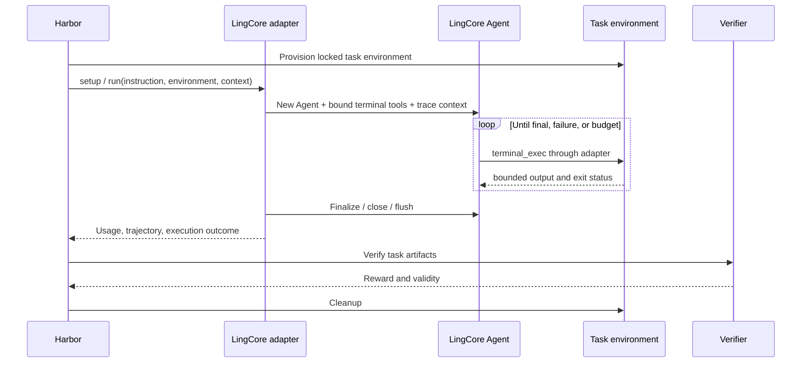

# Terminal-Bench example integration

Status: proposed adapter and evaluation example, researched 2026-10-28.
This document accompanies the
[general tracing and evaluation design](tracing-and-evaluation.md).
No benchmark was run, no score is claimed, and the proposed LingCore commands
and adapter package are not implemented yet.

## Public benchmark and pinned baseline

Terminal-Bench measures agents completing tasks in terminal environments.
Use **Terminal-Bench 4.0.0** as the public baseline for this design. The official
release identifies the dataset as `terminal-bench/terminal-bench@4.0.0` and
points to source commit
`452bf305c6daa62fc59061d22133a7cbc7c1572e`.
Keep earlier releases as separate datasets rather than pooling their scores.
Sources: [release](https://github.com/harbor-framework/terminal-bench/releases/tag/v4.0.0),
[release commit](https://github.com/harbor-framework/terminal-bench/commit/452bf305c6daa62fc59061d22133a7cbc7c1572e).

Version 4.0 changes task membership and resources, fixes tasks, and sets the
agent timeout to eight hours. Therefore a short local development run must
identify its reduced limits. Source:
[Terminal-Bench 4.0 announcement](https://www.tbench.ai/news/terminal-bench-4-0).

The public dataset includes GPU and multi-container workloads. A local Docker
subset is useful for integration work, but does not establish full-suite
coverage. Source:
[Harbor Hub dataset](https://hub.harborframework.com/datasets/terminal-bench/terminal-bench/4).

The upstream dataset selection syntax is currently:

```sh
harbor run -d terminal-bench/terminal-bench@4.0.0
```

That is an upstream command, not a command executed by this design review.
The exact model, agent, sandbox, repetition plan, and resources still need
configuration. The proposed LingCore suite is
[terminal-bench.yaml](examples/evaluation/terminal-bench.yaml).

## Ownership

Harbor provides independent task environments and verification. A task has
`instruction.md`, `task.toml`, an environment definition, tests, and an
optional reference solution. Its verifier produces a numeric reward or named
numeric rewards. Sources:
[task structure](https://docs.harborframework.com/tasks/overview),
[verifier contract](https://docs.harborframework.com/tasks/verifier).

| Responsibility | Owner |
| --- | --- |
| Resolve dataset/tasks and manage environments | Harbor |
| Apply task resources and network policy | Harbor environment provider |
| Agent model loop, context, tools, retries | LingCore |
| Translate terminal actions into environment operations | LingCore Harbor adapter |
| Record agent requests, tools, approvals, usage | LingCore tracing |
| Run the official verifier and determine reward validity | Harbor |
| Preserve raw results and produce shared comparison records | LingCore result importer |
| Decide publishability under current leaderboard rules | Upstream submission process |

Do not rebuild Terminal-Bench's runner, rewrite its tests, or use an LLM judge
to replace its reward. A local report is not automatically an official
leaderboard submission. Uploading is a separate explicit operation.

## Adapter choice: external agent

Harbor supports an installed agent inside the task environment and an external
agent controlling it through `BaseEnvironment`. Custom classes can be selected
with `-a module.path:ClassName`. Harbor generally recommends installed agents;
we choose an external adapter to keep LingCore model credentials, journals,
and evaluation configuration outside the task filesystem. Source:
[custom agents](https://docs.harborframework.com/agents/custom-agents).

Proposed separately packaged import path:
`lingcore_harbor.agent:LingCoreAgent`, implemented against a pinned Harbor
version. It implements the supported `BaseAgent` lifecycle rather than
launching the interactive LingCore CLI.

The terminal profile is a dedicated evaluation profile, not an automatic
modification of the coding profile. The adapter builds the normal LingCore
Agent using a trial-local registry with exactly these tools:

| Tool | Contract |
| --- | --- |
| `terminal_exec` | Execute a command in the assigned Harbor environment; explicit optional cwd and timeout; bounded stdout/stderr plus exit status |
| `terminal_read_output` | Read a bounded range of previously captured output using an opaque, trial-scoped handle |

All actions operate in the same Harbor environment for that trial. Changes to
files persist across calls. A shell's exported variables or current directory
do not implicitly persist across independent calls; the tool description says
so. A persistent PTY and additional environment-aware file/media tools can be
added as separately versioned bindings after this baseline.

The binding reaches the trial's `BaseEnvironment` through a typed
`ToolContext` slot, not through `tool_options` (deep-copied, serializable) or
a module global. Its registry is the injected trial-local registry, so the
profile declares no plugins or skills.

The binding must never use host `run_shell`, `read_file`, `write_file`,
`fetch_url`, browser, process, or external-agent tools as a fallback. Files at
`/app`, `/tmp`, and other task paths are environment paths, not host paths.
Large-output handles cannot name arbitrary host files. Bound capture at the
producer or streaming transport, not only after collecting an unlimited
`ExecResult`. Harbor's environment API is the transport seam:
[BaseEnvironment source](https://github.com/harbor-framework/harbor/blob/main/src/harbor/environments/base.py).

This baseline measures the LingCore loop with a declared terminal toolset.
It is not a measurement of the bundled frontend profile or its browser tools.
Record the binding version and rendered tool schemas in every candidate.

## Construction, model configuration, and permissions

1. Resolve and lock the requested benchmark and exact task list before
   starting work. Validate Harbor package/API compatibility and capabilities.
2. Allocate fresh LingCore runtime state and host-side logs for each execution.
   No user profile memory, session history, local skills, or repository
   instruction files are inherited.
3. Resolve model configuration once. The suite's profile is authoritative in
   `lingcore eval`; a direct Harbor invocation may explicitly override model
   connection settings. Conflicting or unsupported formats fail preflight.
   Record the final backend/model and endpoint alias, never credential values.
4. Bind only the declared terminal tools to the Harbor environment instance.
   Keep the exact profile ceiling. Missing/extra required bindings fail.
5. Apply `benchmark_environment` approval policy only to that environment.
   Record a policy approval for each action. A request for any other capability
   is denied; there is no generic `confirm=lambda _: True`.
6. Run the instruction through the same guardrails, context management,
   retry handling, and tool dispatch as ordinary LingCore execution.
7. Drain usage and flush traces, close the Agent, export the trajectory, and
   return control to Harbor for verification and environment cleanup.

The benchmark command's authorization is scoped to a disposable task
environment. It grants no access to host secrets, Docker sockets, unrelated
workspaces, or unrestricted external services. Network settings come from the
task and harness policy. An adapter must not create a host-side network escape
around a restricted task environment.

The model endpoint is a separate control-plane connection owned by LingCore.
Keep its credentials out of terminal tool environments. Use only task-declared
nonsecret variables or explicitly scoped fixture credentials in the sandbox.
No solution directories, verifier inputs, or expected answers enter model
context. Do not mount the full downloaded benchmark repository into the task.

Capability preflight checks OS, containers, accelerators, network enforcement,
interactive input, task-provided skills/MCP, multimodal needs, and multi-step
features. Unknown/unsupported requirements cannot be silently ignored. The
initial adapter supports Linux command-based tasks only. Each selection key
in the suite (for example `interaction: command`) must map to a documented
field of the pinned task metadata, or to a documented derivation from it.
That mapping is not yet verified against Terminal-Bench 4.0 `task.toml` files.
A key that cannot be read from the metadata fails resolution; it is never
guessed from the task name or instruction text. A full-suite plan
fails preflight if required capabilities are absent; development subsets
record every excluded task and reason.

## Trial lifecycle and cancellation



Harbor owns the trial timeout. Development runs may use a lower LingCore
deadline; the effective limit is the smaller of the two. The eight-hour public
task limit is not an instruction to run that long by default.

Cancelling an awaited environment call does not prove that its remote process
stopped. Before acceptance, the terminal binding must demonstrate ownership and
termination of command process groups on timeout/cancellation for its supported
provider. Track long-lived children and fence further agent writes before
verification. Use a provider capability or an adapter-owned command supervisor;
if neither can provide cleanup, refuse that execution mode.

Cancellation follows LingCore's cancel -> await -> finalize -> close contract.
Preserve partial artifact and usage evidence. Let Harbor decide whether to
grade the remaining task state under its error policy. If command termination
cannot be established, classify the execution as an environment/cleanup error
and invalidate grading rather than racing the verifier.

A fresh infrastructure retry gets a fresh environment. Model transport retries
stay inside the same execution and remain visible. No automatic retry follows
a zero reward or an agent budget failure.

Harbor's current policy can grade agent timeouts and output/context exhaustion
as valid results, while infrastructure/provider errors have different retry
and validity rules. Import the pinned harness classification rather than
guessing from exception text. Source:
[Harbor error classification](https://docs.harborframework.com/jobs/error-classification).

The adapter needs a typed LingCore execution outcome: current frontend
`Error.message` strings alone are insufficient. Add an internal
`ExecutionOutcome` with cause, limit type, and provider error category while
preserving frontend event compatibility. Map known causes to the pinned
Harbor exception classes; preserve unknown causes as unclassified.

## Trace and ATIF mapping

Write the local journal throughout execution. ATIF is a derived exchange
artifact; it does not replace the journal's timings, retries, and lifecycle
records. Export `agent/trajectory.json` through the adapter's log directory
and declare ATIF capability only after schema validation succeeds.
Source: [Harbor ATIF integration](https://docs.harborframework.com/agents/atif).

At research time, the documentation calls the format v1.7, while the source
model defaults to v1.8 and accepts both. Pin the Harbor package and target
schema together; this proposal targets the v1.7 subset and requires validation
with the selected package. Do not infer a schema from a floating documentation page.
Source: [trajectory model](https://github.com/harbor-framework/harbor/blob/main/src/harbor/models/trajectories/trajectory.py).

| LingCore evidence | ATIF representation |
| --- | --- |
| Captured task input | User step |
| Guarded assistant response | Agent step |
| Tool call and returned result | Tool call ID and matching observation |
| Main request usage | Per-step metrics, where representable |
| All request usage, including retries/summary/vision | Final totals plus explicit purpose breakdown in `extra` |
| Context compaction | Context-management/system record supported by pinned schema |
| Cancelled/incomplete response | Marked partial step and execution outcome in `extra` |
| Trace/run/trial identity | `extra.lingcore` references |

Do not synthesize model reasoning, provider token IDs, or missing observations.
Do not place summary/vision usage on an unrelated main-model step. Mark
unattributed usage explicitly. Preserve parallel call IDs even when observation
completion order differs from call order.

ATIF export requires captured conversation/tool content. Metadata-only traces
remain inspectable but cannot be advertised as complete ATIF trajectories.
Redacted/truncated content is labelled, and such a trajectory is not promised
to reproduce the original request. Agent steps use the trace's capture rule:
committed text, with the guarded final reply as its own field, since
tool-call text is not guarded today. Rolled-back text remains marked discarded.

Populate Harbor's agent context with known usage totals and per-model usage,
including cached input as a subset. Preserve unknown costs as null and report
incomplete usage coverage in metadata. Source:
[AgentContext model](https://github.com/harbor-framework/harbor/blob/main/src/harbor/models/agent/context.py).

## Dataset locking, grading, and comparison

The proposed `resolve` step produces a lock with:

- Dataset identifier/version and the release source commit above.
- Exact selected task references, task content hashes, agent-environment and
  verifier identities, required capabilities, and effective resources.
- Harbor package version and artifact hash, adapter version, ATIF target, and
  error-classification policy version.
- Candidate profile/model/tool bindings, repetitions, retry policy, selection
  rationale, limits, and content-capture policy.

The source commit verifies the release, but is not a substitute for locking the
Hub-resolved task packages and images. Resolution must reconcile those sources
and record what will actually run. Missing immutable image references or
network-fetched dependencies are recorded as reproducibility limitations.

Keep original Harbor config, trial result, verifier logs, reward files, and
trajectory alongside normalized results. Import raw named rewards without
inventing a universal pass threshold. For this benchmark, resolve the official
success metric and aggregation from the pinned dataset/harness; reject an
unknown reward schema. The runner itself, not a model-writable file, supplies
provenance and reward validity.

Preserve each task's verifier mode. Current Harbor supports shared and separate
verification; changing that mode or artifact transfer rules can change results.
Do not assume every task verifier is tamper-proof. LingCore never exposes the
verifier as a model tool.

Use two clearly labelled tracks:

| Track | Purpose | Comparability |
| --- | --- | --- |
| Development | Small declared subset, short budgets, often one repetition | Comparable only to the same locked local setup |
| Benchmark | Entire pinned task set, official task resource policy, declared repeated trials | Eligible for comparison after completeness and upstream-rule checks |

The example is a development track with three deterministically selected tasks,
one repetition, and a 15-minute local execution cap. These settings test the
integration. They are not a Terminal-Bench 4.0 headline score.

Selection is resolved before any model run. Sort stable task IDs after the
declared capability filter, select the requested count, and store the complete
included/excluded lists. If too few eligible tasks exist, fail resolution.
For scientific comparison, choose a representative fixed task list and justify
it; alphabetical selection is only an integration smoke policy.

Report per-task reward and validity, planned/valid counts, resources, token
coverage, and separate agent/setup/verifier durations. Comparisons use the same
task revisions and resources. Invalid executions must not silently disappear
from the denominator or be relabelled as solved. Preserve the upstream score
alongside any local descriptive metric with its denominator.

## Implementation and validation plan

This is milestone 3 of the
[implementation sequence](tracing-and-evaluation.md#later-milestones). It
depends on milestone 1 (traces, budgets, typed outcomes, the state directory,
the registry seam) and milestone 2 (locked plans).

1. Pin a compatible Harbor release in an isolated adapter package, without
   changing LingCore's base dependencies. An external agent runs in Harbor's
   Python process, and LingCore pins exact versions (for example `openai`,
   `anthropic`, and `pydantic`). Before any other work, prove that the pinned
   Harbor release and the LingCore release resolve into one environment.
   If they cannot, record the conflict and choose between an installed agent
   and a process boundary around the adapter; never loosen LingCore's pins
   silently. Then validate imports and custom-agent construction against
   that release.
2. Implement the environment-only terminal binding and typed execution
   outcomes. Use a fake environment to prove no host filesystem/shell fallback.
3. Add a synthetic disposable task with a known file artifact and verifier.
   Run the no-op and reference solutions as harness checks, then a scripted
   LingCore client. These are plumbing tests, not benchmark measurements.
4. Validate ATIF and accounting with parallel calls, compaction, retries,
   incomplete responses, cancellation, and missing provider usage.
5. Test real environment process cleanup, timeouts, output bounds, verifier
   ordering, and fresh-state retries on the chosen provider.
6. Resolve and run the declared development subset with a real model; inspect
   every trace and compare normalized results with original Harbor rewards.
7. Expand capability support and run a fixed repeated benchmark plan only when
   the previous gates pass. Keep benchmark-derived data out of default training
   exports and respect the dataset's license and benchmark-use notices.

A future direct Harbor invocation would use the proposed adapter:

```sh
harbor run -d terminal-bench/terminal-bench@4.0.0 \
  -a lingcore_harbor.agent:LingCoreAgent \
  --ak profile=/absolute/path/to/terminal-agent.yaml
```

The `profile` option and adapter in this command are proposed LingCore
components. The module must be installed into the Harbor process environment.
The locked LingCore suite remains the preferred route for reproducible task
selection, explicit development limits, and normalized reports.
