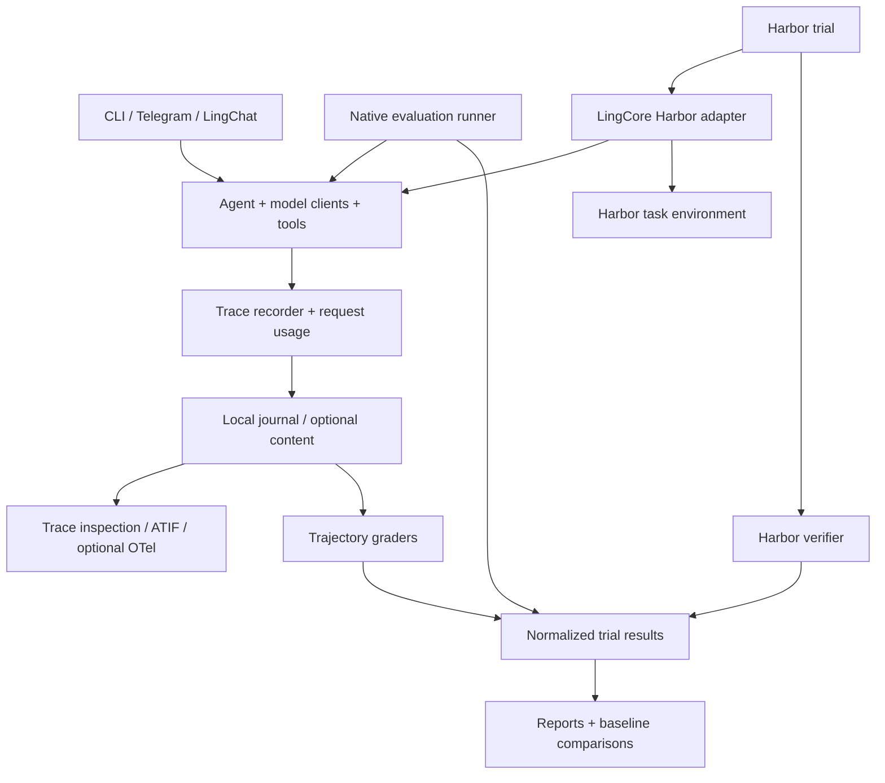

# Tracing and evaluation design

Status: milestone 1 implemented on 2026-10-29; the broader design was reviewed
against LingCore v0.5.1 on 2026-10-28. Milestone 2 (locked plans) is planned
below, and its step 2.1 is done. Harbor, ATIF/OpenTelemetry export, comparison,
retrieval-specific instrumentation, and later-milestone APIs remain proposals.

The current native subset supports sequential local cases with empty workspace
fixtures, scripted text turns, `artifact_text`, and `tool_policy`. It refuses
locked plans, external sources, exports, infrastructure retries, and concurrent
execution. Unknown costs remain null. Output-allowance capping, trace deletion,
and arbitrary fixture copying are not exposed by this subset.

```sh
lingcore eval run docs/examples/evaluation/local.yaml --output /tmp/lingcore-evals
lingcore eval report /tmp/lingcore-evals/<job-id>
lingcore trace show /tmp/lingcore-evals/<job-id>/executions/<execution-id>/trace
```

The model environment names are listed in
[the example setup](examples/evaluation/README.md). CI runs the same example
against a scripted client without paid services. Job directories preserve
per-execution results, bounded output artifacts, traces, and `report.json`;
temporary model workspaces and profile state are cleaned after collection.

Native defaults apply to each omitted limit: 60 seconds, 20 model requests,
and 40 tool calls. Setting another limit does not remove those bounds; explicit
`null` disables a bound. External cancellation propagates from the library
after finalization, cleanup, and best-effort result/report persistence; only
the CLI translates it to exit 130. Grader failures retain the recorded execution
outcome and any independent grader results, with a separate grading diagnostic.

Known-secret replacement uses explicit credential declarations and credential
environment names, not arbitrary exported values. Short credentials match
whole values or credential fields, never substrings of IDs or model names.
Committed content is bounded including item wrappers and separators. Identical
sanitized prompts/tool schemas are captured once per turn; truncation affects
individual values or omitted later items, preserving earlier argument evidence.

The first milestone should answer two questions: why did an agent run behave
this way, and did a change improve task completion? It must work for coding,
daily assistance, retrieval, and future profiles without coupling the agent
loop to a benchmark or a frontend.

The public integration example is
[Terminal-Bench through Harbor](evaluation-terminal-bench.md). A small
[local evaluation example](examples/evaluation/local.yaml) demonstrates the
same result and grading model without Harbor.

## Decisions

| Concern | Decision |
| --- | --- |
| Runtime instrumentation | A small, injected tracing API with a no-op default |
| Frontend events | Preserve the existing `AgentEvent` contract |
| Storage | One append-only JSONL journal per execution run; separate optional content artifacts |
| Usage | Record each model request independently of conversation history |
| Evaluation | Shared trial/result/grader contracts with native and external runners |
| Terminal-Bench | Harbor owns environments and verification; LingCore supplies an external agent adapter |
| Interchange | Export ATIF for trajectories and optionally OpenTelemetry for operational spans |
| Dependencies | No Harbor or OpenTelemetry imports in the base runtime |
| First milestone | Local traces, bounded headless execution, and a minimal native evaluator, delivered as small independently shippable steps |
| Later milestones | Locked plans, the Harbor adapter, repeated-run comparison, and export/frontend polish |

Durable resumption of arbitrary tool execution, distributed orchestration,
automatic prompt optimization, and a hosted trace service are later work.
Trace inspection and evaluation resumption must not promise execution replay.

## Architecture and existing seams



The current [event stream](../lingcore/events.py) is for rendering. In
[Agent._dispatch](../lingcore/agent.py), tool calls run concurrently and results
are returned in batch order. Timing frontend events would therefore mismeasure
individual tool durations. Instrument the actual operations.

[UsageMeter](../lingcore/usage.py) already receives main, summary, and vision
usage. Extend accounting at that seam. Session `turn_stats` are branch-owned
and removed by Edit; they cannot be the authoritative execution ledger.
The existing cancellation handshake, tool ceiling, guardrails, and plugin
policy remain authoritative.

## Trace identity and records

An execution run is one Agent runtime lifetime, or one evaluation execution.
Each acquired `Agent.run()` turn starts a new trace; setup and teardown may have
their own traces. An evaluation execution also has a trial root trace linking
those traces. This avoids keeping an interactive span open for days.

| Identifier | Meaning |
| --- | --- |
| `run_id` | Unique execution identity, never reused on restart or fork |
| `trace_id` / `span_id` | 32/16 lowercase hexadecimal characters, compatible with OTel IDs |
| `event_id` / `seq` | Globally unique record ID / increasing sequence within a run |
| `session_id` / `turn_id` | Optional conversation identity / unique acquired turn |
| `request_id` | One model client invocation, including unsuccessful invocations |
| `tool_call_id` | Provider call ID, scoped by request; a separate span ID identifies execution |
| `trial_id` / `execution_id` | Planned evaluation attempt / a particular infrastructure execution |
| `links` | Causal references to another trace, fork, retry, or monitor producer |

Do not use `Agent._turn_index` as a turn ID: it advances per loop iteration.
Provider request identifiers are optional attributes, never local primary keys.
Capture immutable turn context before any terminal event releases the lease.
When sessions are enabled, `agent.turn` also records the stored user row's
message sequence returned by the append transaction, so a trace can be joined
to the transcript after Edit, rewind, or fork. That sequence is a correlation
attribute, not a trace identity: Edit can delete the row it names.

Proposed journal envelope:

```json
{
  "schema_version": "lingcore.trace.v1",
  "event_id": "01f62f0c-d57c-46d0-bd5a-874363c8da11",
  "run_id": "dce4ca9b-d3e8-448b-9475-dcd2fc846577",
  "seq": 17,
  "timestamp": "2026-10-28T12:00:00.000000Z",
  "elapsed_ns": 2300000000,
  "trace_id": "83bd606337314381b96d7af5f548cacf",
  "span_id": "21b46da6c96d4096",
  "parent_span_id": "8a75436bc74d46a2",
  "turn_id": "84d699b6-5a67-437f-883f-7df073a2fa32",
  "kind": "span.end",
  "name": "tool.execute",
  "status": "ok",
  "attributes": {
    "tool.name": "read_file",
    "tool.call_id": "call_3",
    "duration_ns": 35000000
  }
}
```

Use UTC for correlation and a monotonic clock for durations. `elapsed_ns` is
relative to this run's process-local clock; never subtract clocks across
processes. Events are `span.start`, `span.end`, or `event`. End statuses are
`ok`, `error`, `cancelled`, `denied`, `incomplete`, and `budget_exceeded`.
Unknown additive attributes are ignored by readers; unknown major schemas are
rejected. All attributes must pass a per-event typed allowlist.

## Instrumentation boundaries

| Operation | Capture |
| --- | --- |
| `agent.turn` | Input origin, terminal outcome, iteration count, conversation commit/rollback |
| `prompt.compose` | Layer identities and sizes; configured content only |
| `llm.request` | Purpose, provider/model, request ID, finish reason, TTFT, duration, usage availability |
| `tool.dispatch` | Requested tool, validation and authorization outcome, including rejected arguments |
| `tool.execute` | Actual start/end, result status, output size, attachments; one span per invocation |
| `approval.wait` | Allow/deny/cancel, human or configured policy, waiting time |
| `plugin.hook` | Plugin/hook identity, decision, duration, typed failure |
| `retrieval.query` | Backend, candidate/returned counts, source IDs, stale exclusions, index identity |
| `memory.compact` | Input/output sizes, affected messages, summary request link |
| `retry.backoff` | Cause, next attempt number, delay, previous request link |
| `background.enqueue` | Source identity, dropped-event count, later turn link |
| `evaluation.*` | Prepare, execute, verify, artifact collection, cleanup, and grading |

Instrument at existing seams before adding calls inside the loop body. Every
model request already passes through a duck-typed client (`stream()`): the
main client, which also serves compaction, the memory-condensation summarizer,
and the vision client. One wrapper applied where `Agent.from_profile` builds
or receives those clients therefore covers `llm.py`, `llm_anthropic.py`, and
injected test clients alike, without the loop importing either SDK
(invariant 1). The loop needs explicit records only where no seam exists:
dispatch rejections (unknown tool, invalid arguments, authorization), turn
commit/rollback, compaction boundaries, and finalization.

Main completion, compaction, memory condensation, and vision requests all use
the same request instrumenter, with different `purpose` values. TTFT means
time to the first visible text delta; record first-any-delta separately for
reasoning-only or tool-only responses.

A stream retry creates a new `request_id` linked to the previous request.
The SDK may retry opening HTTP requests internally. Initially record the
configured SDK retry policy and `transport_attempts: null`; do not invent a
one-to-one mapping between SDK requests and HTTP attempts. Transport spans can
be added later where the adapter provides reliable hooks.

Approval recording wraps the supplied `ConfirmFn`. Tool and plugin decisions
that bypass a prompt must emit their own policy-decision record. Recording
never grants a tool or changes a decision.

## Ordering, cancellation, and conversation branches

- Explicit context objects own IDs; `contextvars` are only a propagation
  convenience. Parallel tool tasks receive sibling spans. Threaded work sends
  records through a thread-safe bridge to the run's single writer.
- Use `try/finally` at every operation boundary. Propagate cancellation and
  close spans once. Late cleanup from an old generator must not consume a newer
  turn's usage or close its spans.
- Keep LingCore's cancel -> await driver -> finalize handshake. Record the
  finalization outcome separately: a Stop during a committed observer hook can
  preserve the reply. A runner also calls `Agent.aclose()` in bounded cleanup.
- A rollback event marks which transcript branch was discarded. Completed tool
  effects and request usage remain in the journal. This is historical evidence,
  not a claim that an external write was undone.
- Forks link to the source session/run/message. They do not copy usage records
  into a new billable execution. Resume creates a new run linked to the old one.
- Monitor turns start fresh traces, record `input_origin: monitor`, and link
  back to the producing tool/source. They do not inherit a closed turn context.
- A crash leaves open spans. Inspection reports them as interrupted/unknown.
  Recovery may append a recovery record; it never manufactures successful end
  events or reruns a tool.

## Usage and execution budgets

Add a `RequestUsage` record without breaking `TokenUsage`, `UsageReported`,
or `TurnStatsReported`. It carries request ID, purpose, model, inclusive input
and output counts, cached-input and reasoning subsets, optional cache-write
breakdown, and `availability: reported | missing | partial`.

Capture usage when the provider client reports it, before frontend draining.
Publish one final accounting record per request; deduplicate by
`(run_id, request_id)`, including early generator closure. A request without
usage still has an explicit missing-usage record. Known totals are lower bounds
when any request lacks usage. Estimated tokens must use separate fields.

Preserve raw, allowlisted billing categories where providers distinguish cache
creation and cache reads. Today's inclusive `TokenUsage` totals alone cannot
price all models accurately. Dollar estimates require a versioned price table,
currency, model mapping, and pricing timestamp. Unknown prices yield null cost,
not zero. Never add cached tokens to inclusive input tokens a second time.

Introduce a separate `ExecutionBudget`, enforced independently of trace
delivery. It tracks the whole trial across turns and all model roles:

| Limit | Enforcement |
| --- | --- |
| Wall time | Monotonic deadline; includes retries, tools, and approval waits |
| Requests | Reserve a slot before every main/summary/vision invocation |
| Tool calls | Reserve before dispatch; count rejected calls too |
| Reported tokens | Check before the next request; an in-flight request can overshoot |
| Output allowance | Opt-in only: cap a request's output by the remaining allowance |
| Automatic turns | Bound monitor wakeups independently of human turns |
| Estimated cost | Advisory initially; show incomplete billing coverage |

Token and dollar limits cannot guarantee a precise billing ceiling when usage
is missing or arrives only after a stream ends. Strict evaluation mode stops
before another request if required usage is unavailable. Record that as
`usage_unavailable`, not as an exhausted token allowance.

Exhaustion ends the trial instead of being reported to the model. Under
invariant 5 a raising tool becomes `ToolResult(ok=False)` and the model simply
continues, so a refused admission cannot be implemented as a tool error. The
budget raises a dedicated `BudgetExceeded` signal that the loop treats as a
terminal outcome: no further request or dispatch is admitted, the turn ends
with an `Error` event for frontends, and the typed `ExecutionOutcome` records
the limit that was hit. A wall-time deadline is enforced by the driver
cancelling the run and completing the normal Stop handshake. The driver
records `timed_out` from its own decision, because the rollback alone is
indistinguishable from a user Stop.

The output allowance is off by default. A request cut short by it finishes
with `length`, which invariant 5 turns into an incomplete-response `Error`.
The budget would then change the outcome it is measuring, so a suite that
enables it records the setting in its candidate fingerprint.

Native workers enforce deadlines independently of the event consumer. An
external harness owns its deadline; the adapter may apply a smaller development
budget and records the effective minimum. Setup, verification, and cleanup have
separate deadlines. Token/request admission never depends on an optional trace
writer keeping up.

## Storage, content policy, and failure behavior

Proposed layout outside the model-visible workspace:

```text
<state>/traces/<run_id>/
  manifest.json           # immutable sanitized configuration/provenance
  events.jsonl            # append-only, one writer
  artifacts/              # optional bounded, sanitized content
  summary.json            # atomic derived view, rebuildable
```

Tracing is disabled by default. When enabled, metadata is the default capture
mode. `content: redacted` explicitly captures bounded user/assistant text,
tool arguments/results, and prompt/tool definitions needed for inspection.
Reasoning text, signed provider blocks, credentials, environment values, HTTP
headers, and arbitrary exception strings are excluded in both modes. Trace
content capture is separate from any existing session reasoning setting.

Content capture records what the conversation committed, not what a frontend
displayed. Today `post_output` runs only on a tool-free final reply and on an
incomplete response. Two cases follow from that:

- Text that accompanies tool calls is committed without the guardrail.
- A completed final reply is committed to memory and SQLite before
  `post_output` runs, so only the `Final` event carries the guarded text.

The trace therefore captures committed text plus, for a final reply, the
guarded text as a separate field. This keeps it consistent with the session
transcript. It does not claim that every stored assistant message was guarded.
Closing that gap (guarding before commit, or guarding tool-call text) is a
separate core change and would apply to sessions and traces together.
For attempts discarded before commit (stream retries, rolled-back turns), keep
metadata and usage without persisting their partial text.

Redact before enqueueing or hashing captured content. Do not serialize
`ToolContext`, entire profiles, or SDK objects. Paths and URLs can contain
secrets: metadata uses logical source IDs; content mode applies path/URL
sanitization. Known-secret replacement is defense in depth, not proof that
arbitrary user content is anonymous. Exports preserve capture/redaction markers.

Use existing no-follow confined file primitives, private permissions where
supported, record/artifact/total byte caps, and bounded flush intervals.
An incomplete last JSONL line after a crash is ignored with an explicit warning.
All prior complete lines remain inspectable. Sequence gaps and dropped records
make trace completeness false.

The recorder enqueues without awaiting filesystem or network I/O. The queue
has fixed capacity. Overflows and disk errors increment out-of-band health
counters, surfaced in the run result even if the journal is unwritable.
Interactive mode fails open with a value-free diagnostic. Evaluations with
`trace.required: true` become invalid for trace-dependent grading if capture
is incomplete; a valid independent artifact/verifier score is still preserved.
Never retry agent execution because a trace sink failed.

`max_bytes` bounds a run's journal plus its artifacts. An interactive Agent
can live for days, so reaching the cap is an expected state. Capture stops for
the rest of that run. The journal's last record is a value-free cap marker,
completeness becomes false, and a single diagnostic is shown. Existing records
are never rotated away or rewritten, because deleting a prefix would make
earlier spans unverifiable. A new Agent runtime (`/new`, `/resume`, a
restarted Telegram user runtime) starts a new run with its own allowance.

Flush has a bounded shutdown allowance and cannot mask an active cancellation
or tool error. Retention is explicit: deleting a conversation does not implicitly
delete its trace; a trace deletion operation removes the journal and content
artifacts together. No exporter uploads data automatically.

Proposed interactive profile configuration:

```yaml
tracing:
  enabled: true
  path: traces
  content: metadata
  queue_capacity: 4096
  flush_interval_seconds: 1
  max_bytes: 67108864
  artifact_max_bytes: 4194304
```

The new `tracing` block is optional and defaults to disabled. Relative paths
resolve against private profile state; absolute paths require explicit opt-in.
Reject a trace destination inside the installed package. Also reject any
overlap with the model-visible workspace in either direction: the destination
must not be inside the workspace, and the workspace must not contain it. Check
this at Agent assembly against the *effective* workspace (after `--workspace`
or a frontend override) using resolved paths, not at profile load. Telegram
gives each user a trace root beneath that user's state directory, like their
memory and sessions database (invariant 17). An evaluation runner supplies its
own private run directory and the suite's capture policy. Record that
effective policy in the manifest.
Flushing makes a complete record visible to readers; durable sync boundaries
are separately recorded, and a power loss may lose the last unsynced interval.

## Proposed runtime API and implementation locations

Interfaces below show ownership, not drop-in code:

```python
class TraceSink(Protocol):
    def try_emit(self, record: TraceRecord) -> bool: ...
    async def flush(self, timeout_seconds: float) -> TraceHealth: ...


class TraceRecorder:
    def span(
        self, name: str, *, parent: SpanContext | None, attributes: Mapping[str, Scalar]
    ) -> SpanScope: ...
    def event(
        self, name: str, *, context: SpanContext, attributes: Mapping[str, Scalar]
    ) -> None: ...


class TrialExecutor(Protocol):
    async def execute(
        self, spec: TrialSpec, context: TrialContext
    ) -> ExecutionResult: ...


class Grader(Protocol):
    async def grade(self, evidence: TrialEvidence) -> GradeResult: ...
```

`SpanScope` handles exception/cancellation classification and exactly-once
closure. The no-op recorder has the same API. `TraceRecord` and
`TrialEvidence` are immutable typed values. A grader declares whether it
requires complete metadata, captured content, or filesystem artifacts.

| Proposed module | Responsibility |
| --- | --- |
| `lingcore/tracing/{models,context,recorder,local}.py` | SDK-independent schemas, IDs, recorder, storage |
| `lingcore/tracing/{inspect,export}.py` | Offline inspection and optional exporters |
| `lingcore/execution.py` | Scripted `Frontend`, deadline, typed outcomes, budget admission |
| `lingcore/evaluation/{models,config,runner}.py` | Suites, trials, native executor |
| `lingcore/evaluation/{identity,lock,jobs}.py` | Plan digests, lock files, job ledger, resume and attempt selection |
| `lingcore/evaluation/{graders,report}.py` | Deterministic graders, aggregation, comparison |
| `integrations/harbor/lingcore_harbor/` | Separately packaged optional adapter and ATIF export |

`Agent.__init__` and `Agent.from_profile` gain optional execution context and
recorder parameters. Model adapters instrument client invocations; tool
dispatch, hooks, compaction, and confirmations instrument their actual
boundaries. This requires small core changes: plugin hooks alone cannot observe
every model request, invalid call, or cancellation.

The headless driver is a `Frontend` for the existing `run_session`, not a
second turn loop. `read_input` returns the case's scripted turns and then
`None`. `confirm` applies the suite's approval policy. Event rendering feeds
the outcome collector. `supports_background` is false unless the suite allows
automatic turns. This reuses the cancel -> await -> finalize handshake,
inbox gating, and usage draining unchanged. The deadline and budget are owned
outside the event consumer, so a slow consumer cannot extend them.

For alternate environments, add an explicit tool-registry injection seam to
profile assembly. Its names must cover the configured ceiling exactly; missing
bindings fail construction. No fallback to a global host tool registry.
Existing callers continue to use the current assembly behavior. In the first
version, an injected registry is mutually exclusive with `plugins:`, `skills:`,
and skill modules. Those load into the global `REGISTRY`, and silently
mixing the two would blur which binding produced a tool. An
environment handle such as a Harbor `BaseEnvironment` cannot go in the
`tool_options` dict, which is deep-copied and must stay serializable. It
travels in a typed `ToolContext` slot set by the binding (invariant 2).

### Profile source and state

Today one profile directory serves two roles. It is the source of read-only
inputs (the YAML, `persona.include` files, `skills_dir`, prompt commands). It
also holds writable state (`memory.md`, `sessions.db`, the calendar, and
proposed traces). Fresh-state evaluation needs these separated: copying a
whole profile directory would carry the source profile's memory and sessions
into a trial. Add an explicit state directory to assembly. Source paths keep
resolving against the profile file; state paths resolve against the state
directory, with the same confinement rules. Interactive callers pass none, so
both roles stay in one directory and nothing changes for them. The runner
creates an empty private state directory per execution, then copies only the
declared fixtures. `lingcore.profiles.initialize_profile` already performs
an atomic template-to-state copy and is the starting point to reuse.

## Evaluation model

- **Suite:** versioned task source, candidate profile, repetitions, limits, and
  reporting policy.
- **Case:** stable ID/revision, agent-visible input, fixture/environment,
  declared capabilities, grader specifications, and optional tags.
- **Trial:** one planned `(case, candidate, repetition)` evaluation. Its
  identity is fixed before execution.
- **Execution:** one attempt to run a trial, including infrastructure retries.
  A retry receives a new run/environment; it cannot inherit partial solutions.
- **Grade:** versioned measurement over immutable evidence. Regrading creates
  another grade record and does not overwrite execution history.
- **Candidate:** resolved model, profile/prompt/tool configuration, runtime and
  adapter versions, sampling, and policy.

Keep agent-visible inputs separate from evaluator-only fixtures, expected
answers, reference solutions, and graders. Fresh state includes workspace,
profile memory/calendar, sessions, plugin state, and retrieval indexes.
Only explicitly declared initial fixtures are copied. Multi-turn cases share
state inside their trial, never across unrelated trials.

Native execution proceeds through:

```text
resolve -> preflight -> prepare -> execute -> collect -> grade -> cleanup -> report
```

The collection point must preserve evidence before cleanup removes an
environment. Cleanup is attempted in a finally block after every failure.
Evaluation artifacts are treated as untrusted files: bounded regular-file
reads, no symlink escape, no executable HTML rendering in reports.

Native execution is unattended, so `run_shell` (and the `process` plugin) in a
native candidate requires a configured `tool_options.run_shell.sandbox`. A
candidate whose ceiling includes `run_shell` with the legacy host runner fails
preflight. This matches the `process` plugin's sandbox requirement and
Telegram's refusal of unconfirmed shell (invariants 7 and 17). No approval
policy can substitute for an isolation boundary.

Each case declares the tools it needs (`requires.tools`). Preflight fails
when the candidate's ceiling does not provide them, so a missing tool is a
configuration error, not a task failure.

Preflight verifies configuration, tools, grader requirements, resource support,
credentials by name, and exact source selection. Resolving external sources may
download metadata; validation of an existing lock is offline. Neither action
starts a model call or a task container.

Initial native graders:

| Grader | Evidence and result |
| --- | --- |
| `artifact_text` | Confined output file matched against declared exact text |
| `json_schema` | Structured output validated against a versioned schema |
| `tool_policy` | Required/forbidden calls, argument predicates, causal ordering |
| `citation` | Source exists, cited range matches, source revision is known |
| `command` | Pinned verifier in a disposable evaluation environment |
| `external_reward` | Raw external verifier result plus its validity/provenance |

Natural-language judging is optional later: pin rubric, judge model, and
sampling; report judge usage separately; retain explanations and calibration
examples. An agent's own claim of success never substitutes for a verifier.

Trajectory assertions use request and tool IDs, not string matching rendered
logs. With parallel tools, assert required causal relationships rather than a
single incidental global order. Missing required trace evidence yields
`not_evaluable`, not a pass.

## Outcomes and reports

Separate execution outcome, grading validity, and capture health:

```json
{
  "schema_version": "lingcore.eval-result.v1",
  "trial_id": "greeting--candidate-a--1",
  "execution_id": "83ef3097-87a1-4d88-b8a0-e6dce324ba92",
  "execution": {"status": "completed", "cause": null},
  "grade": {
    "status": "valid",
    "passed": true,
    "scores": {"artifact": 1.0, "tool_policy": 1.0}
  },
  "usage": {
    "input_tokens": 1200,
    "output_tokens": 150,
    "coverage": "complete",
    "estimated_cost_usd": null
  },
  "trace": {"complete": true, "content": "redacted"},
  "comparison": {"track": "development", "benchmark_compatible": false}
}
```

Execution statuses include completed, failed, timed_out, budget_exceeded,
cancelled, and interrupted. Causes distinguish agent, provider, environment,
verifier, configuration, policy, and runner failures. Grading is valid,
invalid, or not_run. A timed-out agent can still have a valid grade for the
artifact it produced; a normal final reply can fail every verifier assertion.
Preserve external error codes and reward-validity decisions rather than mapping
all exceptions to zero reward.

Native suites declare a success rule, initially `all_required`: every required
grader must be evaluable and pass. Secondary scores do not silently change
success. External suites retain their upstream reward semantics.
For the example `tool_policy` grader, `arguments` is a subset predicate over
validated arguments and `causal_order: [[A, B]]` requires a matching successful
A invocation to finish before a matching successful B invocation starts.
It does not require every call to A to precede every call to B.
An argument a tool declares as a workspace path is compared after resolving
both sides against the trial workspace. `hello.txt`, `./hello.txt`, and the
absolute in-workspace path therefore all match, and a path escaping the
workspace never does. Other arguments compare exactly.
`forbid` matches *attempted* calls, including ones rejected at dispatch as
unknown or unauthorized. A forbidden name outside the ceiling is therefore
still meaningful: it detects the model trying to reach a tool it was not given.

Report planned, started, valid, invalid, unsupported, cancelled, and missing
trial counts; failures among valid trials; per-case results; latency; tool
errors; retries; usage coverage; and cost coverage. For equally repeated cases,
the headline is mean per-case single-attempt success, not best-of-N.
For incomplete runs, publish coverage and valid-only descriptive scores, but
withhold a benchmark-comparable headline. An optional lower bound counts
missing/invalid trials as unsuccessful and must be labelled as such.

Estimate uncertainty by resampling cases with all their repetitions together.
Compare baseline/candidate on the same case revisions and repetition plan;
report paired task-level differences and uncertainty. Pass@k is a separately
labelled optional statistic with its sampling assumptions, never a renamed
best attempt.

## Reproducibility and CLI

Resolve the plan into a lock before execution. Record exact task membership,
source revisions/content hashes, image digests where available, verifier
revision, harness/package versions, LingCore commit and dirty-state digest,
profile/prompt/tool/skill hashes, model identifier and endpoint alias, sampling,
limits, approval policy, network/resource settings, and grader versions.
Mutable dependencies or model aliases are explicit reproducibility limitations.
Do not hash secret values into public manifests.

Each plan fixes repetition count, order/seed, concurrency, and infrastructure
retry policy. A retryable infrastructure execution replaces no historical
record. Only the declared policy selects a valid execution for the same trial;
agent failure or a poor reward never triggers another chance.

Proposed commands:

```sh
lingcore eval run docs/examples/evaluation/local.yaml --output /tmp/lingcore-evals  # milestone 1, unlocked
lingcore eval resolve docs/examples/evaluation/local.yaml --lock /tmp/local.lock.json
lingcore eval validate --lock /tmp/local.lock.json
lingcore eval run --lock /tmp/local.lock.json --output /tmp/lingcore-evals
lingcore eval resume /tmp/lingcore-evals/<job-id>
lingcore eval regrade /tmp/lingcore-evals/<job-id>
lingcore eval report /tmp/lingcore-evals/<job-id>
lingcore eval compare <baseline-job> <candidate-job>
lingcore trace show <run-directory>
lingcore trace export <run-directory> --format atif --output <trajectory.json>
```

`resolve` prints the exact planned case/repetition count and limits.
`run` refuses a changed lock/config. Running a suite file directly executes an
unlocked development plan; it is refused when the suite sets
`lock.required: true`, and its results are never benchmark-comparable.
Exit codes: 0 = complete and declared gates pass; 1 = complete with valid task
failures/gate failures; 2 = invalid or incomplete evaluation/configuration, or
lock drift; 130 = user interruption. `resolve` and `validate` exit 0 or 2.
Artifacts are written for every exit path.

Resume schedules only unfinished planned trials from the same lock. Previously
running executions become interrupted. An interruption produced no grade, so
resume replaces it from fresh state without consuming the infrastructure retry
allowance. Every interrupted execution stays in the job and is counted in the
report, so an operator stopping unpromising trials remains visible. Regrade
requires preserved evidence sufficient for that grader; it must refuse when a
destroyed environment was required. It never silently reruns the agent.

Comparison refuses to assert equivalence when dataset revisions, verifier
semantics, tool bindings, or resource policies differ. An exploratory report
may show both, with the differing configuration displayed.

## Implementation sequence and acceptance criteria

### Milestone 1: local traces and a minimal native evaluator

Each step ships independently, keeps the full existing suite green, and leaves
tracing disabled by default. Steps 1.1-1.4 form the tracing track. Steps 1.5
and 1.6 have no dependency on tracing and can proceed in parallel with it.
Steps 1.7 and 1.8 need the earlier steps.

All eight steps below are implemented. Deterministic tests cover the local
sink, runtime request/turn/tool lifecycle, state separation, execution driver,
and the native example. The remaining sections describe the broader intended
contract as well as the implemented milestone-one subset noted above.

1. **1.1 Trace records and local sink.** Add `lingcore/tracing/{models,
   context,recorder,local}.py`: IDs, the envelope, the no-op recorder,
   `SpanScope`, the bounded queue, the single JSONL writer, and health
   counters. Nothing in the runtime calls it yet. Accept: exactly-once span
   closure under exceptions and cancellation, queue overflow and disk-error
   counters, sequence gaps marking a trace incomplete, a crash-truncated last
   line ignored with a warning, and records written through confined
   no-follow primitives.
2. **1.2 Profile block and request instrumentation.** Add the optional
   `tracing:` profile block (disabled by default), path confinement, the
   effective-workspace overlap check, and Telegram per-user roots. Wrap the
   client seam in `Agent.from_profile` and add `RequestUsage`. Accept: one
   accounting record per request for the main, summary, memory-condensation,
   and vision purposes on both backends. Also: explicit missing usage, stream
   retries as linked requests, an incomplete response, and an early-closed
   generator not double-counting. `TokenUsage`, `UsageReported`, and
   `TurnStatsReported` stay unchanged.
3. **1.3 Loop and tool instrumentation (metadata only).** Add `agent.turn`,
   `prompt.compose`, `tool.dispatch`, `tool.execute`, `approval.wait`,
   `plugin.hook`, `memory.compact`, `retry.backoff`, rollback/finalization
   records, and the session-sequence correlation attribute. Accept: sibling
   spans for parallel tools, Stop during parallel tools, and a late old
   generator closing after a new turn starts. Also: unknown-tool and
   invalid-argument rejections recorded, rollback and fork accounting, and no
   change to authorization or decisions.
4. **1.4 Content capture and inspection.** Add `content: redacted`, the
   artifact store, the committed-versus-guarded capture rule, the
   `max_bytes` cap marker, and `lingcore trace show`. Accept: metadata mode
   stores no conversation text, redacted mode excludes reasoning and
   credentials, discarded attempts store no partial text, and inspection
   reports interrupted spans and incomplete capture.
5. **1.5 Profile state directory.** Add the source/state split to assembly,
   reusing `initialize_profile` where it fits. Accept: interactive behavior
   is unchanged when no state directory is passed. With one, memory, sessions,
   calendar, and traces land only in it, and confinement rules still apply.
6. **1.6 Budgets and typed outcomes.** Add `ExecutionBudget`, the
   `BudgetExceeded` terminal signal, and `ExecutionOutcome`, enforced
   independently of trace delivery. Accept: request, tool-call, and token
   exhaustion end the trial instead of feeding an error to the model. Also:
   exhaustion during a stream retry, strict `usage_unavailable`, and frontend
   `Error` events unchanged.
7. **1.7 Scripted frontend driver.** Add `lingcore/execution.py` as a
   `Frontend` for `run_session` plus a driver-owned deadline. Accept: a
   deadline cancellation records `timed_out` through the normal Stop
   handshake, `Agent.aclose()` runs on every exit path, and automatic turns
   are impossible unless the suite allows them.
8. **1.8 Minimal native evaluator.** Add `lingcore/evaluation/{models,config,
   runner,graders,report}.py` with the suite/case schemas, `requires.tools`,
   the sandbox preflight for shell, fresh state per execution,
   `artifact_text`, `tool_policy`, the result schema, and a per-case report.
   `lingcore eval run <suite>` executes an *unlocked* plan, and every result
   records `locked: false` and `benchmark_compatible: false`. Accept: every
   trial gets fresh state, cleanup runs on all terminal paths, missing
   required trace evidence yields `not_evaluable`, and the
   [local example](examples/evaluation/local.yaml) runs against a fake client.

### Milestone 2: locked plans

Milestone 1 runs whatever the suite files say at the moment of execution.
Milestone 2 first freezes that plan into a lock file. A run is then
reproducible, an interrupted job can be resumed, and two jobs from one lock can
be compared. The local example is the acceptance fixture. Milestone 3 reuses
the lock format through a new source kind. File formats, the job layout, and
per-step tests are in the
[locked evaluation plans implementation plan](evaluation-locked-plans.md).

Decisions:

- A lock is canonical JSON (`lingcore.eval-lock.v1`) with a digest over its
  body. It holds digests, names, versions, and the ordered trial list. It never
  holds secret values or absolute host paths, so it can be committed and shared.
- Candidate identity is measured, not inferred. Resolution assembles the Agent
  offline, with a client that is never called and a throwaway state directory.
  It hashes the composed initial system prompt and the effective tool schemas,
  alongside the resolved configuration and the source files assembly read.
- A case has two digests: its agent-visible input (turns, fixture,
  requirements) and its graders. A run refuses a change to either. A regrade
  accepts a grader change and refuses an input change.
- Trials stay sequential (`concurrency: 1`). Parallel trials belong with
  repeated runs in milestone 4.
- Interruption is not an infrastructure retry; see
  [Reproducibility and CLI](#reproducibility-and-cli).

Step 2.1 is done. Steps 2.2 and 2.3 build the lock, and 2.4 needs both.
Steps 2.5 and 2.6 need 2.4. Step 2.7 needs only 2.2 and can proceed in parallel
with 2.5 and 2.6. Step 2.8 closes the milestone.

1. **2.1 Milestone 1 follow-ups (done).** Fix what locks and resume depend on.
   - Narrow the known-secret set to the values of variables named by credential
     fields (`api_key_env`, `token_env`, retrieval provider keys) and of
     credential-named variables, replaced longest first; a value shorter than
     eight characters is replaced only as a whole value. Previously every
     exported value of eight or more characters counted, which redacted
     `llm.model` in trace metadata and gave different models the same
     candidate fingerprint.
   - Let outer cancellation propagate. The driver and the runner record the
     execution and then re-raise; only the driver's own deadline becomes
     `timed_out`. A wall-time refusal at admission also maps to `timed_out`, so
     the classification does not depend on which check fires first.
   - Print and store the value-free reasons of preflight errors that LingCore
     raises itself. Parser and validation messages stay hidden.
   - A grader exception yields `not_evaluable` and never rewrites the execution
     outcome.
   - Count the capture wrapper against `artifact_max_bytes`, so an oversized
     turn loses individual items rather than the whole turn. Capture the system
     prompt and tool schemas once per distinct digest, not every iteration.
   - Unset keys in a partial `limits:` block keep their defaults instead of
     becoming unlimited; `null` disables a limit explicitly.

   Accept: the model name survives in metadata; a fixture key appears in no
   journal, artifact, plan, or lock; a caller's cancellation propagates after
   the execution is recorded; a long turn keeps its tool-argument evidence.
2. **2.2 Plan identity.** Add `lingcore/evaluation/identity.py`: canonical
   serialization and SHA-256 digests for the suite, each case's input and
   graders, the candidate, and the runtime. The candidate covers the resolved
   profile with `base_url` reduced to an endpoint alias (the host, or a
   declared `agent.endpoint_alias`), the model and vision model IDs, sampling,
   the measured prompt and tool-schema digests, environment variable *names*,
   and digests of the source files assembly read (YAML, layers, includes,
   engaged skill and plugin files). The runtime covers the LingCore version, a
   digest of the installed package files, a best-effort git commit and dirty
   flag, and pinned dependency versions. Grader kinds carry a version.
   Resolution refuses a resolved configuration that contains a known secret
   value, which invariant 4 already forbids. Accept: two resolutions of
   unchanged inputs give identical digests; each input change moves exactly its
   own digest; no model call, network access, or secret value.
3. **2.3 Lock file, `eval resolve`, and `eval validate`.** Add
   `lingcore/evaluation/lock.py`. The lock records suite and case paths
   relative to the lock file with their digests, candidate and runtime identity,
   limits, approval policy, trace capture, retry policy, grader versions, the
   explicit ordered trial list, and `limitations` such as `runtime_dirty` or an
   unverifiable model alias. Its source is a discriminated union, so milestone
   3 adds a `harbor` kind without a new major schema. `resolve` writes the lock
   by exclusive create and prints the planned trials and limits. `validate`
   re-derives identity offline and names each drifted field without printing
   values. Accept: the local example resolves and validates. Each drift class
   (case input, grader, profile, persona file, tool schema, runtime, model,
   limits) is reported by name with exit 2. A corrupt lock, an unknown major
   version, or a mismatched self-digest is rejected.
4. **2.4 Lock-checked run.** `eval run --lock <lock>` validates first and
   refuses drift before it creates any state or makes a model call. The job
   stores the exact lock bytes and digest, and trial IDs come from the lock.
   Results and the report record `locked: true` and `lock_digest`;
   `benchmark_compatible` stays false on the development track. Unlocked
   `eval run <suite>` is unchanged. Accept: a drifted lock produces zero
   executions; two jobs from one lock carry the same digest; unlocked results
   remain `locked: false`.
5. **2.5 Job ledger and resume.** Add `lingcore/evaluation/jobs.py`. Execution
   records stay append-only: `trial.json` at the start, `result.json` at the
   end, and an `interrupted.json` that resume writes for an execution that
   started but never finished. The trace sink writes straight into the
   execution directory, so a crash leaves a partial journal for resume to
   inspect. `eval resume <job>` re-validates the job's
   stored lock against current inputs, marks interrupted executions, and runs
   only trials without a selected execution, in lock order. A confined lock
   file in the job directory refuses a second concurrent run or resume.
   Accept: after a simulated crash, resume runs only the unfinished trials and
   never reruns a completed one; drifted inputs are refused; interrupted
   executions are counted in the report.
6. **2.6 Infrastructure retries and attempt selection.** Replace the fixed
   `infrastructure_retries: 0` with a count plus `retry_on` causes: `runner`
   and `environment` by default, and opt-in `provider_transient`. That needs a
   typed category on `LLMStreamError` that separates transient failures (rate
   limit, server error, connection, an exhausted SDK open budget) from request
   failures (invalid or too large); `retryable=False` covers both today. Agent
   errors, budget exhaustion, timeouts, and failed grades are never retried.
   The selected execution is the first in attempt order that is not a
   retryable infrastructure failure. When retries run out, the trial is
   invalid. Reports show usage for the selected executions and for all
   executions. Accept: an infrastructure failure followed by a success selects
   the second execution; an agent failure or a poor reward is never retried; a
   later, better attempt is never chosen over an earlier valid one; exhaustion
   makes the trial invalid.
7. **2.7 Regrade.** `eval regrade <job>` grades preserved evidence again with
   the current graders and writes `grades/<grade-id>.json` beside each
   execution's result, never modifying the result. Graders declare the evidence
   they need: complete metadata, captured content, or a collected artifact
   path. Artifacts are stored by normalized path and digest so any grader can
   find them. `resolve` and `validate` use the same declarations, so an
   argument predicate under `content: metadata` fails preflight instead of
   becoming `not_evaluable` at run time. Regrade accepts a grader change and
   refuses a case-input change; a later profile or runtime change does not
   matter, because the evidence already exists. It also refuses, by name, evidence
   that was never preserved, such as a new artifact path in a destroyed
   workspace. It never runs the agent. Accept: the original grade is
   unchanged; a corrected grader produces a new record; missing evidence is
   refused.
8. **2.8 Reports and exit codes.** Report schema v2 adds the lock digest,
   attempts per trial, interrupted and replaced counts, the grade set in use,
   and selected-versus-all usage. `eval report <job> --grades <grade-id>`
   selects a regrade. `resolve`, `validate`, `run`, `resume`, and `regrade`
   follow the exit codes above on every path, including Ctrl-C; each writes
   its artifacts and prints the job path before exiting. Accept: an exit-code
   test per command and path, and the example README updated to the locked
   workflow.

### Later milestones

3. **Public benchmark adapter.** Implement the
   [Harbor contract](evaluation-terminal-bench.md), validate ATIF against the
   pinned package, run a synthetic harness fixture and then a declared small
   Terminal-Bench subset. Accept: verifier failure is distinguished from
   reward zero.
4. **Regression comparison.** Add repeated runs, paired reports, uncertainty
   estimates, `eval compare`, and content-aware retrieval/calendar cases. Keep
   live-model jobs opt-in with explicit resource and token limits.
5. **Frontend/export polish.** Add a LingChat trace link and timeline, richer
   retrieval cards, and an optional OTel exporter after the local format works.

Normal CI runs deterministic fixtures with fake clients and no paid services.
Harbor contract tests use fakes plus a separately enabled disposable-container
smoke test. Full public benchmarks remain explicit jobs, not pull-request gates.
